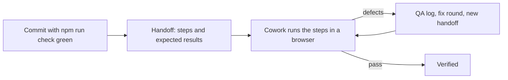

# CI/CD

**There is no working CI/CD pipeline.** Checks run on the developer's machine, and nothing is
deployed automatically. This page describes what exists instead.

## What runs, and where

| Step                               | How                                                                    | Where                  |
| ---------------------------------- | ---------------------------------------------------------------------- | ---------------------- |
| Typecheck, lint, unit tests, build | `npm run check` (stops at the first failure)                           | Local, before a commit |
| Browser suite                      | `npm run e2e` against a served production build                        | Local, per task        |
| Browser verification by Cowork     | A separate agent follows each task's handoff                           | Cowork, per task       |
| Release                            | None. There are no tagged releases ([RELEASE_NOTES](RELEASE_NOTES.md)) | n/a                    |

Commits are `<TASK>: <short title>`, and are pushed to GitHub after each batch.
Nothing on the GitHub side checks them.

## The verification loop

This is the project's substitute for a review-and-staging stage. Its limits: Cowork is a separate
agent that this repo cannot invoke, and the loop is manual (a report is pasted into a Claude Code
session). Details: [TESTING](TESTING.md#the-verification-loop) and
[development/VERIFICATION.md](development/VERIFICATION.md).

## The unused workflow

`.github/workflows/nextjs.yml` is the stock "Deploy Next.js site to GitHub Pages" template that
came with the project. It is **unused and unmaintained**:

- It would run on pushes to `main`, install dependencies, run `next build` and upload `out/` to
  GitHub Pages.
- It sets up **Node 20**, while `engines` requires Node 22 or newer, so it would not meet the
  project's own requirement.
- It runs no typecheck, lint or tests.
- It was never confirmed to work, and GitHub Pages is not enabled for the project, so no demo link
  exists ([DEPLOYMENT](DEPLOYMENT.md)).

Treat it as a starting point, not as a statement of how the project is built.

## What a real pipeline would need

If the project were hosted, the minimum would be a workflow that uses Node 22, runs
`npm ci && npm run check`, builds the static export, and publishes `out/`. The browser suite could
follow in a second job: it needs `npx playwright install chromium`, a build served on a port, and
`npm run e2e`. The error-region spec additionally needs a second build with
`NEXT_PUBLIC_QA_HOOKS=1`. None of this has been set up or tested.
