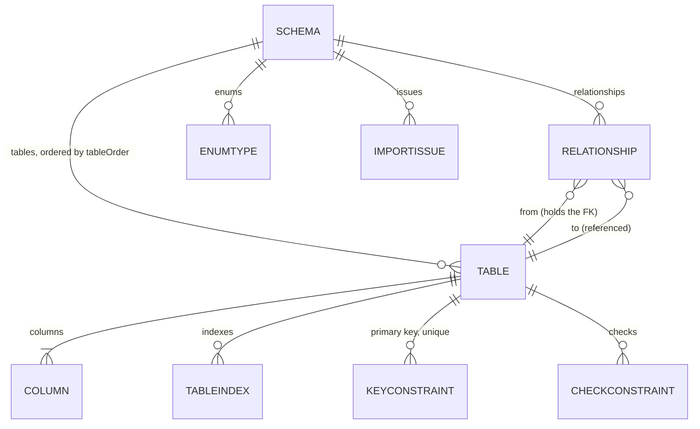

# Database design

SchemaFlow has no database server. Its "data model" is the normalized `Schema` held in memory, plus
two kinds of browser storage for convenience. This page covers both.

## The `Schema` model

Defined in `src/domain/schema/types.ts`. Every importer (SQL, Prisma, samples) ends in one
`normalizeSchema()` call that produces it; the canvas, list, inspector, search, health checks,
path finder and exporters are all derived from it. It is never edited by the UI.

| Type           | Notes                                                                                                                                                               |
| -------------- | ------------------------------------------------------------------------------------------------------------------------------------------------------------------- |
| `Schema`       | `name`, `source` (format, dialect, `importedAt`), `tables` and `relationships` as records, `tableOrder`, `enums`, `issues`                                          |
| `Table`        | `id`, `name`, optional `schemaName`, `columns`, `primaryKey`, `uniqueConstraints`, `indexes`, `checkConstraints`, `origin` (`declared` or `implicit`), `partitions` |
| `Column`       | `dataType` (raw text, lower-cased base, params, array flag, enum name), `nullable`, `default`, `isPrimaryKey`, `isForeignKey`, `isUnique`                           |
| `Relationship` | `from` (FK side) and `to` (referenced side) with column IDs, `onDelete`, `onUpdate`, `cardinality` (`many-to-one` or `one-to-one`), `origin`                        |
| `ImportIssue`  | `severity` (`error` or `warning`), `message`, optional `line`, `statement`, `table`, `tableId`                                                                      |

**IDs are deterministic.** A table ID is schema-qualified when a schema name is known
(`public.users`); a column ID is `<tableId>.<column>`; relationship IDs come from `relationshipId()`.
The same input always gives the same IDs, which is what makes saved layouts and tests stable.

**Fingerprint.** `fingerprintSchema()` hashes the table structure. It keys everything saved per
schema. Adding or removing a table or column changes it, so positions do not carry over
([ADR-025](development/ARCHITECTURE.md#adr-025--layout-persistence-per-fingerprint-localstorage-keys-2026-11-19-p3-t01)).

**Layout is separate from data.** `DiagramLayout` (positions, edge routes, collapse modes, viewport,
direction) lives in `layout-store`, keyed by fingerprint, never inside `Schema`.

## Browser storage

| Where                  | Key                                  | Holds                                                       |
| ---------------------- | ------------------------------------ | ----------------------------------------------------------- |
| localStorage           | `schemaflow:layout:v1:<fingerprint>` | Positions, collapse modes, viewport, direction (and routes) |
| localStorage           | `schemaflow:layout-index:v1`         | Usage order for the 20-layout least-recently-used limit     |
| localStorage           | `schemaflow:prefs:v1`                | Preferences such as neighbourhood depth                     |
| localStorage           | `schemaflow:session-ui:v1`           | Selected table and inspector tab for the restored import    |
| IndexedDB `schemaflow` | store `session`, key `current`       | Last import: `{ v, text, format, name, savedAt }`           |

How it behaves:

- **Layouts** are written per fingerprint, debounced 300 ms and flushed on page hide. A stored layout
  is used only if every table has a finite position and the direction is valid; otherwise the app
  lays out again. At most 20 are kept; on a quota error the oldest are evicted. Layouts over
  1.5 M characters drop their edge routes.
- **Session restore** stores the import's source text, not the parsed schema, and re-parses it on
  load, so parser fixes apply and no versioned migration is needed
  ([ADR-030](development/ARCHITECTURE.md#adr-030--session-restore-indexeddb-source-text-re-parsed-on-load-2026-11-19-p3-t06)).
  `?sample=` loads win and neither read nor change the session.
- **Failure is quiet.** `src/lib/safe-storage.ts` wraps every access in try/catch, and the IndexedDB
  helper resolves every call with a 2 s timeout. Blocked storage, private mode or a full quota only
  mean nothing is saved.
- **Clear saved data** (Settings or More, with a confirm dialog) removes all of the above and loads
  the sample.
- **Multi-tab:** last write wins; there is no sync between tabs.

## What does not exist

No SQL database, migrations, ORM, server storage or accounts. The parsed `Schema` itself is never
persisted: storing it was considered and rejected because it would need versioned migrations and
would keep stale parser output.
