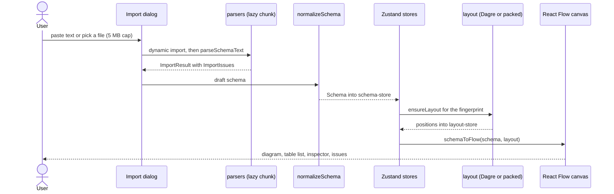
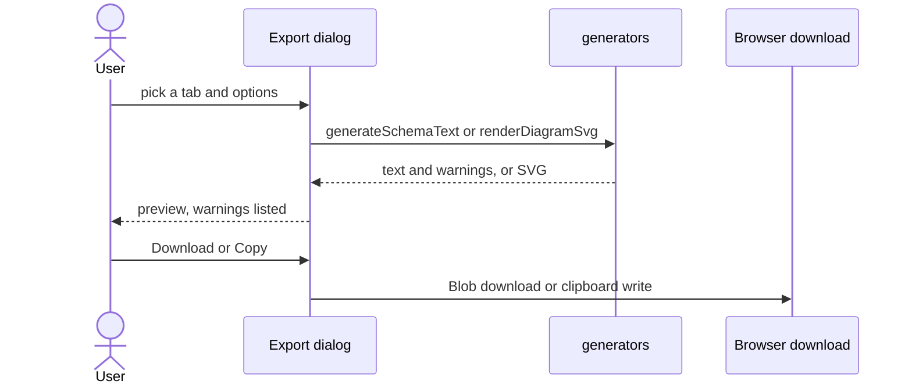
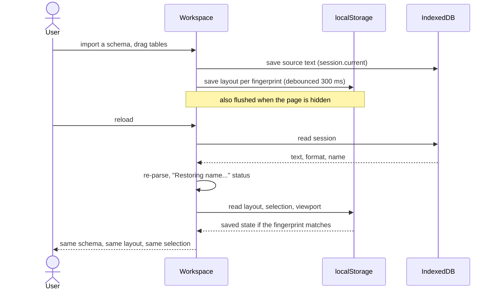

# Data flow

How data moves through SchemaFlow, as sequence diagrams. The static pipeline diagram is in
[diagrams/data-flow.md](diagrams/data-flow.md); the overview is [ARCHITECTURE](ARCHITECTURE.md).
Nothing here crosses a network: every arrow stays inside the browser tab.

## Import to render

Points worth knowing:

- Parsing runs on the main thread after one `setTimeout(0)`, so "Parsing..." paints first
  ([ADR-014](development/ARCHITECTURE.md#adr-014--import-dialog-lazy-parsers-on-the-main-thread-no-web-worker-2026-11-16)).
- Parsers never throw on user data. A statement they cannot read becomes an `ImportIssue` and the
  rest of the file still imports.
- `ensureLayout` loads a saved layout for this fingerprint if one is valid, otherwise it lays out
  and saves.
- The canvas reads the stores with narrow selectors; `schemaToFlow` is the only place nodes and
  edges are built.

## Export

Generation is stale-safe: if the user changes options while one is running, the older result is
dropped ([ADR-029](development/ARCHITECTURE.md#adr-029--one-export-dialog-with-tabs-preview-and-stale-safe-generation-2026-11-19-p3-t05)).
PNG export rasterises the generated SVG in the browser.

## Persistence and restore

Rules: `?sample=` loads that sample and neither reads nor changes the session; with no record, no
IndexedDB, a read slower than 2 s or a parse with no tables, the app falls back to the sample.
"Clear saved data" deletes all of it and loads the sample
([ADR-030](development/ARCHITECTURE.md#adr-030--session-restore-indexeddb-source-text-re-parsed-on-load-2026-11-19-p3-t06),
[DATABASE_DESIGN](DATABASE_DESIGN.md#browser-storage)).
