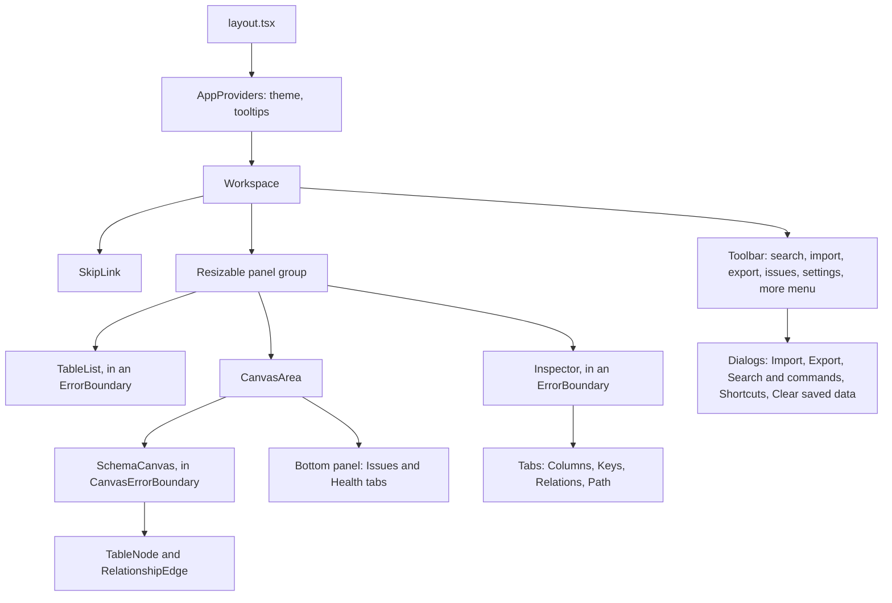

# Frontend architecture

The whole app is frontend. This page covers the component tree, the stores, the canvas, routing and
the feature boundaries. Overview: [ARCHITECTURE](ARCHITECTURE.md).

## Routing

There is one route. `src/app/page.tsx` is a static server component that renders the client
`Workspace`; `layout.tsx` wraps it in `AppProviders` (theme, tooltips). The app reads `?sample=`
from `window.location.search` in an effect (static export has no request-time APIs,
[ADR-002](development/ARCHITECTURE.md#adr-002--static-export-cache-components-disabled-2026-11-13)).
`error.tsx` and `global-error.tsx` are the app-level error pages.

## Component tree

Below the `md` breakpoint the table list and inspector are overlay sheets
([ADR-021](development/ARCHITECTURE.md#adr-021--phone-table-list-sheet-enter-on-resize-separators-2026-11-16-p2-t10)).
Closed side panels are `inert` so hidden controls cannot take focus
([ADR-018](development/ARCHITECTURE.md#adr-018--neighbourhood-highlighting-and-inert-panels-2026-11-16)).

## Feature folders

| Folder                          | Owns                                                                       |
| ------------------------------- | -------------------------------------------------------------------------- |
| `components/workspace`          | Shell, toolbar, table list, panel sizing, session restore, area filter     |
| `components/canvas`             | React Flow canvas, table node, edge, zoom detail, notices, canvas commands |
| `components/inspector`          | Columns, Keys, Relations and Path tabs, collapse control                   |
| `components/issues`             | Bottom panel with the Issues and Health tabs                               |
| `components/import`, `export`   | The two dialogs and their helpers                                          |
| `components/search`, `commands` | Search palette, commands, the one shortcut table and help dialog           |
| `components/errors`             | Error boundaries, region fallbacks, build-time crash hooks                 |
| `components/ui`                 | shadcn/ui primitives (Radix underneath)                                    |

Features talk to each other through the stores and small shared helpers (for example
`stores/reveal.ts`, which search, issues and the inspector all use to jump to a table), not by
importing each other's internals.

## State

Diagram: [the three stores](diagrams/stores.md).

| Store          | Owns                                                                                                |
| -------------- | --------------------------------------------------------------------------------------------------- |
| `schema-store` | The `Schema`, fingerprint, issues, imported source text, restore status                             |
| `layout-store` | Positions, collapse modes, viewport and direction per fingerprint                                   |
| `ui-store`     | Selection, panels, search, inspector tab, neighbourhood depth, focus set, active path, hidden areas |

Rules: narrow selectors, `useShallow` for object or array selectors, no DOM access inside stores.
Selection lives in `ui-store` rather than in React Flow
([ADR-008](development/ARCHITECTURE.md#adr-008--node-selection-owned-by-ui-store-2026-11-13)), so the
canvas, the list and the inspector agree.

## Canvas

- `schemaToFlow()` builds nodes and edges; it runs only when the schema, a collapse mode or the
  layout "version" changes ([ADR-009](development/ARCHITECTURE.md#adr-009--rebuilding-react-flow-nodes-only-on-layout-version-changes-2026-11-13)).
  Between those events React Flow owns transient drag state, and the final position goes to
  `layout-store` on drag stop.
- `nodeTypes` and `edgeTypes` are module-scope constants; `TableNode` and `RelationshipEdge` are
  `memo`ed and read one boolean each (selected, dimmed).
- Above 80 tables React Flow renders only visible elements; above 300 tables a dismissible notice
  appears.
- Neighbourhood dimming is a derived `focusSet` in `ui-store`; an active path wins over it.
- Motion is skipped under `prefers-reduced-motion`.

## Feature boundaries that matter

- Canvas components never import parsers; only the Import dialog does, through a lazy `import()`.
- Pure logic (path finding, health, subject areas, table details) lives outside `components/` and
  is tested without a DOM.
- Keyboard shortcuts, the command palette and the help dialog all read one `SHORTCUTS` table
  ([ADR-037](development/ARCHITECTURE.md#adr-037--commands-in-the-own-palette-and-one-shortcut-table-2026-11-23-p4-t04)).
