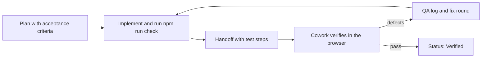

# Testing

Three layers of automated checks, plus a separate manual verification loop that this repo cannot run
for itself.

## Layers

| Layer                | Tool                                  | Runs in                   | Command                             |
| -------------------- | ------------------------------------- | ------------------------- | ----------------------------------- |
| Static               | TypeScript strict, ESLint 9, Prettier | Node                      | `npm run typecheck`, `npm run lint` |
| Unit and component   | Vitest 5, Testing Library, jsdom      | Node, jsdom for UI        | `npm run test`                      |
| Browser (end to end) | Playwright (Chromium only), axe-core  | A served production build | `npm run e2e`                       |

`npm run check` runs typecheck, lint, test and build, in that order, stopping at the first failure.
It must be green before a commit. The browser suite is **not** part of it, because it needs a built
and served app plus a browser ([ADR-024](development/ARCHITECTURE.md#adr-024--committed-playwright-e2e-suite-2026-11-19-e2e-01)).

## Unit and component tests

Tests sit next to the code they cover. Pure modules (domain, graph, parsers, analysis, generators)
run in Node; component tests declare `// @vitest-environment jsdom`.

What is tested, and how:

- **Parsers:** fixtures in `tests/fixtures/sql/` and real-world dumps in `tests/fixtures/real/`, plus
  robustness and regex-backtracking tests ([SECURITY](SECURITY.md)).
- **Generators:** fixed-point tests (import, export, import again, compare) and a hostile-name
  schema (`src/test/hostile-schema.ts`).
- **Samples:** reference counts for the e-commerce sample are asserted
  (12 tables, 71 columns, 13 relationships; see [VERIFICATION](development/VERIFICATION.md)).
- **Components:** behaviour through Testing Library and user-event, with shared fakes in `src/test/`
  (fake storage, fake session backend, DOM mocks).
- **Performance budgets:** `*performance.test.ts` assert wall-clock limits. Vitest runs them in a
  separate project, one file at a time, after the rest ([PERFORMANCE](PERFORMANCE.md)).

Run `npm run test:coverage` for a V8 coverage report. No coverage threshold is enforced.

## Browser suite

`tests/e2e/*.spec.ts`, one file per area: import, issues, health, path, search, inspector,
neighbourhood, panels, phone (390×844), persistence, session, export, collapse, areas, shortcuts,
zoomed-out, packed-layout, error-regions, a11y and two bug-bash specs.

- The suite never starts a server. Build and serve first (`npm run build && npm run start`, which
  serves `out/` with Python's `http.server`), then `npm run e2e`. Set `E2E_BASE_URL` if the app is
  not on port 3000.
- One worker by default: the static server resets connections when two browsers load chunks at once.
- Assertions use `data-testid`, `data-*` attributes and ARIA state, never pixels or fixed timeouts.
  Input is real mouse and keyboard; the only synthetic input is the file drop.
- `error-regions.spec.ts` needs a build made with `NEXT_PUBLIC_QA_HOOKS=1` and
  `E2E_QA_HOOKS=1`; without them it is skipped.
- `a11y.spec.ts` runs axe with WCAG 2.0 and 2.1 A and AA rules on ten states in light and dark
  ([ADR-038](development/ARCHITECTURE.md#adr-038--accessibility-audit-with-axe-2026-11-24-p4-t06)).
  It found one real defect (icon-only toolbar buttons without a name). It is also flaky when axe
  reads colours during a dialog fade-in (QA-045), and QA-043 and QA-044 are open accessibility
  issues, all won't fix ([KNOWN_ISSUES](KNOWN_ISSUES.md)). "Zero axe violations" therefore describes
  the states the spec covers, not the whole app.

## Counts

Stamped: **2026-11-24, at `f66a33c`.** `npx vitest run`: 107 test files, 863 tests, all passing, in
about 63 seconds on a loaded M1. The browser suite has 254 e2e tests. Run results, stamped:
Cowork round 29 at `64c5aa7`: 233 passed, 1 failed (the `a11y.spec` dark dialogs, flaky, QA-045),
20 skipped. Claude Code's P4-T06 run: 234 passed, 20 skipped. A text count of the spec files
undercounts, because parameterised tests expand into several runs. These numbers change with every
task.

## The verification loop

Claude Code writes the code and runs the automated checks above. A separate agent, Claude Cowork,
verifies behaviour in a real browser, logs defects in [QA_LOG](development/QA_LOG.md), and Claude
Code fixes them with regression tests.

A task is only called **Verified** after a Cowork report has been pasted back and logged. Until then
its status is "Awaiting Cowork verification". No human or Cowork result is claimed on this page
beyond what the QA log records ([QA_REPORT](QA_REPORT.md)).

## Gaps

- No visual regression tests, no cross-browser runs (Chromium only), no mobile device testing beyond
  the 390×844 emulation, no screen-reader walkthrough.
- Reduced-motion behaviour is covered by unit tests only; Cowork could not emulate it.
- No mutation testing and no coverage gate.
