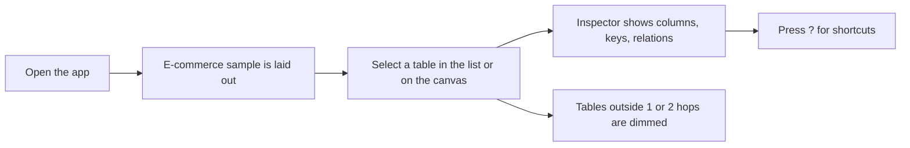
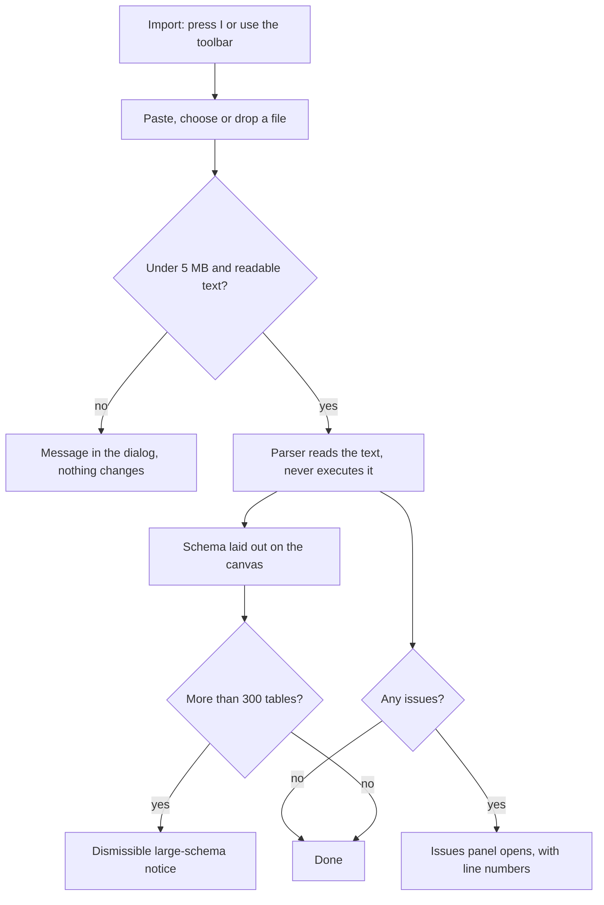
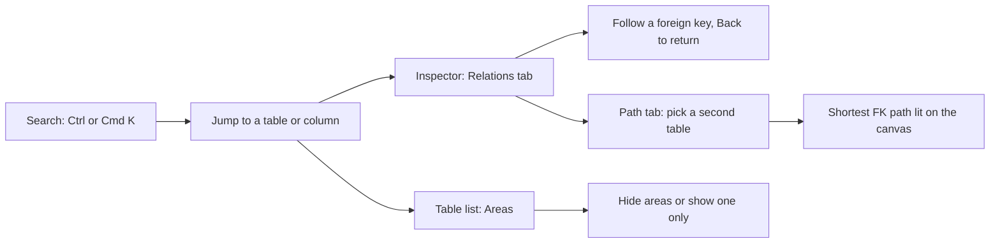
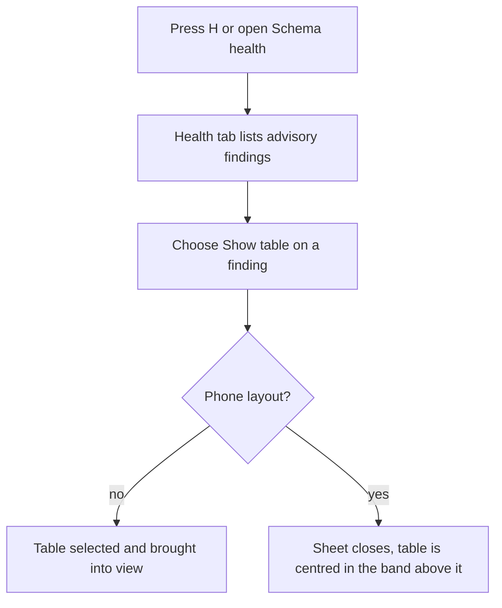
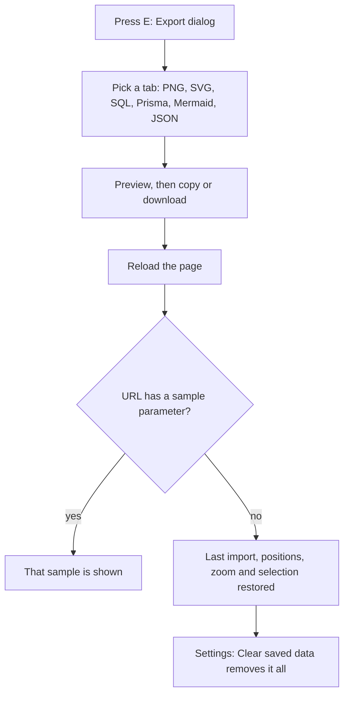

# User flows

Five journeys through the app. Each lists the Playwright spec that exercises it
(`npm run e2e`, see [the e2e decision](development/ARCHITECTURE.md#adr-024--committed-playwright-e2e-suite-2026-11-19-e2e-01)).

## 1. First look

The app opens on the built-in e-commerce sample (12 tables). Specs:
[panels.spec.ts](../tests/e2e/panels.spec.ts), [neighbourhood.spec.ts](../tests/e2e/neighbourhood.spec.ts).

## 2. Import your own schema

Specs: [import.spec.ts](../tests/e2e/import.spec.ts), [issues.spec.ts](../tests/e2e/issues.spec.ts).

## 3. Understand a schema

Specs: [search.spec.ts](../tests/e2e/search.spec.ts), [inspector.spec.ts](../tests/e2e/inspector.spec.ts),
[path.spec.ts](../tests/e2e/path.spec.ts), [areas.spec.ts](../tests/e2e/areas.spec.ts).

## 4. Review quality

Specs: [health.spec.ts](../tests/e2e/health.spec.ts), [phone.spec.ts](../tests/e2e/phone.spec.ts).

## 5. Take it away and come back

Specs: [export.spec.ts](../tests/e2e/export.spec.ts), [persistence.spec.ts](../tests/e2e/persistence.spec.ts),
[session.spec.ts](../tests/e2e/session.spec.ts).

