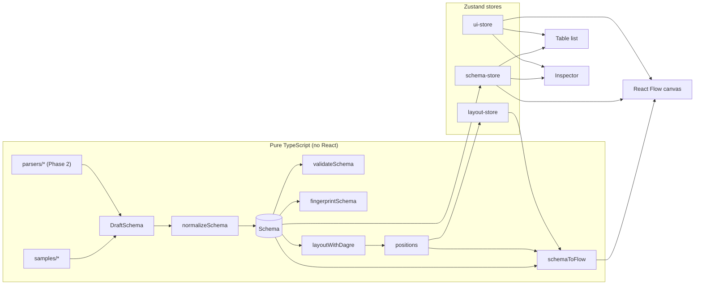

# Architecture

SchemaFlow is a static, client-only Next.js app. A schema (sample now; SQL/Prisma import in
Phase 2) is normalized into one in-memory `Schema` model, from which the React Flow diagram, the
table list and the inspector are derived. Nothing is sent to a server and imported SQL is never
executed.

## Data flow

1. `src/app/page.tsx` (server component, static) renders the client `Workspace`.
2. On mount, `Workspace` reads `?sample=…` from `window.location.search`, builds the sample and
   calls `schema-store.loadSchema()`. `layout-store` computes Dagre positions for the schema's
   fingerprint if none exist.
3. `SchemaCanvas` derives nodes/edges with `schemaToFlow()` when the schema, collapse modes or a
   layout "version" (re-layout / reset) changes. Between those events, React Flow owns transient
   node state (`applyNodeChanges`) and drag-stop writes the final position back to `layout-store`.
4. Selection lives in `ui-store` (`selectedTableId`). `TableNode` and `RelationshipEdge` subscribe
   with a boolean selector (`s.selectedTableId === id`), so a selection change re-renders only the
   affected node(s)/edges — the nodes array is not rebuilt.

## Module boundaries

| Path                  | Responsibility                                             | May import                   |
| --------------------- | ---------------------------------------------------------- | ---------------------------- |
| `src/domain/schema`   | Types, IDs, normalize, validate, fingerprint, selectors    | nothing app-specific         |
| `src/samples`         | E-commerce sample, synthetic generator, `?sample=` parsing | domain                       |
| `src/graph`           | `schemaToFlow`, Dagre layout, node metrics, handle IDs     | domain, `@xyflow` types only |
| `src/stores`          | Zustand slices                                             | domain, graph                |
| `src/components`      | React UI (`workspace/`, `canvas/`, `ui/` = shadcn)         | everything above             |
| `src/parsers` (P2)    | SQL / Prisma → `DraftSchema`                               | domain                       |
| `src/analysis` (P4)   | Health checks                                              | domain                       |
| `src/generators` (P3) | Schema → SQL/Prisma/Mermaid                                | domain                       |

Rules: pure modules have zero React/Next/DOM imports and are unit-tested; parsers never import
React Flow; canvas components never import parsers. `src/graph` imports only _types_ from
`@xyflow/react`.

## Data model

Defined in `src/domain/schema/types.ts`, following the Phase 1 spec with these refinements:

- `ImportResult` is a discriminated union on `ok` (`ok: true` guarantees `schema`).
- Named helper types (`DataType`, `KeyConstraint`, `TableIndex`, `CheckConstraint`,
  `RelationshipEnd`, `EnumType`, `CollapseMode`, `LayoutDirection`, `Viewport`) instead of inline
  object types.
- `Column.isUnique` means "covered alone by a unique constraint or unique index" (PK excluded).
- PK columns are forced `nullable: false` during normalization.
- `DraftSchema` (`draft.ts`) is the importer contract: string names, optional inline `references`,
  table-level `foreignKeys`, detached `foreignKeys`/`indexes` (ALTER TABLE / CREATE INDEX) and
  `defaultSchemaName` (e.g. `public`).

`normalizeSchema(draft)`:

- IDs: `tableId = schema ? "schema.name" : "name"`, `columnId = "<tableId>.<column>"`,
  `relationshipId = "fk:<from>(<cols>)-><to>"` (suffixed `#2…` if duplicated).
- Names resolve case-insensitively (`NameLookup`). An explicit schema must match exactly; otherwise
  the default schema is tried, then the bare name. Names that differ only in case are ambiguous.
- Unresolved tables/columns, missing target PKs and column-count mismatches become `warning`
  issues and the relationship is skipped. Duplicate/empty table names are `error`s (table skipped).
  Nothing throws for user data.
- `cardinality = one-to-one` when the FK column set equals (as a set) the PK, a unique constraint
  or a unique index of the FK table; otherwise `many-to-one`.

`validateSchema(schema)` re-checks invariants (key/id agreement, unique column IDs, ownership,
key columns exist, relationships reference existing tables and their own columns, equal column
counts, `tableOrder` consistency). The sample must produce zero issues.

`fingerprintSchema` hashes sorted, lower-cased `table(columns)` strings with cyrb53
(`sf1-<base36>`): independent of order, types and metadata, so re-importing the same tables
finds the same saved layout (Phase 3).

`selectors.ts`: `getOutgoingRelationships`, `getIncomingRelationships`, `buildAdjacency`,
`getNeighbors(schema, id, depth)` (undirected BFS, excludes the start table).

### Phase 2 import mapping

**SQL** (implemented in P2-T01…T03, hand-written parser, ADR-012). `src/parsers/sql`:

- **Tokenize:** a dialect-aware tokenizer (strings, quoted identifiers, `$tag$` bodies, nested
  comments).
- **Split:** top-level `;` tokens only.
- **Per statement:** each statement is parsed independently.
  - `CREATE TABLE` → `DraftTable`: columns; inline and table-level PK / UNIQUE / CHECK / FK with
    ON DELETE/UPDATE; MySQL `KEY`/`INDEX`.
  - `ALTER TABLE … ADD [CONSTRAINT]` → table patch, or a detached FK.
  - `ALTER COLUMN … SET/DROP DEFAULT`, `SET/DROP NOT NULL` and `ADD GENERATED … AS IDENTITY` →
    column patches.
  - `CREATE [UNIQUE] INDEX` → detached index; expression indexes are skipped with a warning.
  - `CREATE TYPE … AS ENUM` → enum.
- **Defaults** are classified as:
  - literal (casts stripped);
  - function (`name(...)`);
  - expression (`CURRENT_*`, other);
  - autoincrement (serial, identity, `AUTO_INCREMENT`, `AUTOINCREMENT`, `nextval(...)`).
- **Tolerance:** unknown column options are skipped, never fatal.
- **Ignored statements:** `SET`, `SELECT`/`set_config`, `OWNER TO`, `GRANT`/`REVOKE`,
  `COMMENT ON`, sequences, extensions, functions/triggers, schemas, transactions, `DROP`,
  `INSERT`, `PRAGMA`, `USE`, `LOCK` are counted into **one** summary warning.
- **Per-statement warnings with line numbers:** other statements (e.g. `CREATE VIEW`),
  unparseable statements, expression indexes, and FKs to missing tables (from normalize).
- **Result:** the draft goes through the existing `normalizeSchema`/`validateSchema`.
  `parseSql` returns an `ImportResult` and never throws. SQL is treated purely as text and never
  executed.
- **Lazy loading:** the whole `src/parsers` module will be loaded with a dynamic `import()` by the
  Import dialog (P2-T05), so it isn't in the initial bundle.
- **Not supported:** `COPY … FROM stdin` data blocks (use a schema-only dump, `pg_dump -s`), MySQL
  `DELIMITER` blocks (reported), and table inheritance or partitions (options ignored).

**Identifier case.** PostgreSQL folds unquoted identifiers to lowercase; MySQL and SQLite
preserve them. SchemaFlow keeps names **as written** (quotes removed) and matches table and column
names **case-insensitively** everywhere (`NameLookup`). As a consequence, two tables that differ
only in case (e.g. quoted `"UserID"` and unquoted `userid`, which PostgreSQL treats as distinct)
collide: the second is reported as `Duplicate table … (names are matched case-insensitively)` and
skipped. This is a deliberate trade-off for predictable lookups; revisit if real schemas need it.

**Prisma** (own parser, ADR-013; `src/parsers/prisma`): lexer (line breaks are tokens; `///`
doc comments kept) → block parser (one logical line per member; line breaks inside `(…)`/`[…]`
continue the line, but a line that starts like a member always starts a new one) → mapping.

- `model` → table (name from `@@map`, schema from `@@schema`); scalar and enum fields → columns
  (name from `@map`); `?` → nullable, otherwise NOT NULL; `[]` scalar lists → array types.
- **Types:** a native `@db.*` type wins (`@db.VarChar(255)` → `varchar(255)`,
  `@db.UnsignedInt` → `int unsigned`, `@db.DoublePrecision` → `double precision`); enum fields use
  the enum's database name (`@@map`); other scalars stay **as written in Prisma** (`String`,
  `DateTime`). We don't guess provider default types, which differ by provider and Prisma version.
  `Unsupported("x")` → `x`.
- `@id`/`@@id` → PK; `@unique`/`@@unique` → unique; `@@index`/`@@fulltext` → indexes (`map` or
  `name` as the key name).
- `@default`: `autoincrement()`/`sequence()` → autoincrement; `dbgenerated("expr")` → expression;
  other calls (`now()`, `uuid()`, `cuid()`) → function; values → literal, as written.
- Relation fields are not columns. `@relation(fields, references, onDelete, onUpdate, map)` → a
  foreign key on that model, with field names resolved to `@map` column names.
- Implicit many-to-many (list relation fields on both sides, neither with `fields`) → join table
  `_AToB` (models sorted by name; `_Name` for a named relation) with `origin: "implicit"`, columns
  `A`/`B` typed like the referenced ids, a unique (A, B) index, an index on B and two
  `prisma-implicit` foreign keys with cascade actions. Needs a single-field `@id` on both models.
- `datasource.provider` sets `source.dialect` (`postgresql`/`postgres`/`cockroachdb`, `mysql`,
  `sqlite`; others → none); PostgreSQL uses `public` as the default schema, like SQL import.
- **Warnings (line-numbered):** unparseable lines, unknown blocks, missing `}`, unterminated
  strings, views (skipped), unknown field types (kept as written), relations with unknown fields.
  Duplicate tables are errors, as for SQL.

## State slices (`src/stores`)

| Store          | Holds                                                                                                                                                                                                                                                                                                                                                                                        |
| -------------- | -------------------------------------------------------------------------------------------------------------------------------------------------------------------------------------------------------------------------------------------------------------------------------------------------------------------------------------------------------------------------------------------- |
| `schema-store` | `schema`, `fingerprint`, `issues`; `loadSchema()`                                                                                                                                                                                                                                                                                                                                            |
| `layout-store` | `DiagramLayout` per fingerprint (positions, collapsed, viewport, direction), `version` counter bumped on re-layout. Persisted to localStorage in Phase 3.                                                                                                                                                                                                                                    |
| `ui-store`     | `selectedTableId`, `tableFilter`, `showMiniMap`, `leftPanelOpen`/`rightPanelOpen`, `focusRequest` (`{ tableId, nonce }`, consumed by the canvas to center a table), `clearRequest` (counter bumped by `clearSelection()` on Escape, which is a `document` keydown listener; the canvas unpins a clicked edge). Theme preference is owned by `next-themes` (localStorage, class on `<html>`). |

Components use narrow selectors; `useShallow` where a selector returns an object/array.

## Performance strategy

- Nodes carry only `{ tableId, mode }`; components look up the (immutable) table by ID.
- `nodeTypes`/`edgeTypes` are module-scope constants; `TableNode`/`RelationshipEdge` are `memo`ed.
- Selection/highlight are per-component boolean selectors — no nodes-array rebuild on select.
- Positions are written to `layout-store` on drag **stop**, not on every drag frame.
- `onlyRenderVisibleElements` is enabled automatically above 80 tables
  (`LARGE_SCHEMA_THRESHOLD` in `src/components/canvas/schema-canvas.tsx`).
- No animated edges; MiniMap off by default; no continuous animation loops; viewport transitions
  are skipped under `prefers-reduced-motion`.
- Dagre runs synchronously on load/re-layout (~180 ms for 200 tables in Node on an M1).

Profiling guidance: React DevTools → Profiler → "Highlight updates when components render".
Selecting a table should re-render only the previously and newly selected `TableNode`s, their
connected `RelationshipEdge`s, the inspector and the matching list items. Panning/zooming should
re-render no `TableNode`.

## Chosen versions (2026-11-13)

| Package                                              | Version                  | Notes                                                             |
| ---------------------------------------------------- | ------------------------ | ----------------------------------------------------------------- |
| next                                                 | 16.4.6                   | App Router, Turbopack, `output: "export"`                         |
| react / react-dom                                    | 19.3.0                   |                                                                   |
| typescript                                           | 5.x (`^5`)               | as pinned by create-next-app; TS 7 not yet adopted (ADR-005)      |
| tailwindcss / @tailwindcss/postcss                   | 4.3.5                    | CSS-first config in `globals.css`                                 |
| shadcn (CLI, dev)                                    | 4.23.0                   | style `radix-nova`, base `radix`                                  |
| radix-ui                                             | 1.8.x                    | single-package Radix primitives used by shadcn                    |
| cn                                                   | 0.5.x                    | shadcn's compiled `clsx` + `tailwind-merge` replacement (ADR-004) |
| lucide-react                                         | 1.72.x                   | icons                                                             |
| react-resizable-panels                               | 4.22.x                   | via shadcn `resizable`                                            |
| @xyflow/react                                        | 12.12.1                  | base stylesheet imported in `globals.css`                         |
| zustand                                              | 5.1.0                    |                                                                   |
| @dagrejs/dagre                                       | 3.1.3                    | ESM, named `Graph`/`layout` exports                               |
| next-themes                                          | 0.4.6                    | class strategy                                                    |
| vitest / @vitest/coverage-v8                         | 5.1.0                    | Vite 8, JSX via built-in oxc transform                            |
| jsdom                                                | 31.0.1                   |                                                                   |
| @testing-library/react / user-event / jest-dom / dom | 16.3 / 14.6 / 7.0 / 10.4 |                                                                   |
| eslint / eslint-config-next                          | 9.x / 16.4.6             | flat config; `next lint` no longer exists                         |
| prettier / prettier-plugin-tailwindcss               | 3.10.1 / 0.8.1           |                                                                   |

No SQL or Prisma parser dependency (ADR-012, ADR-013). Not installed until needed: `html-to-image`
(Phase 3).

## Decision records

### ADR-001 — Tailwind via `@tailwindcss/postcss` (2026-11-13)

- **Decision:** Use `@tailwindcss/postcss` with `postcss.config.mjs`.
- **Context:** create-next-app 16.4 scaffolds a Turbopack-specific `@tailwindcss/turbopack` loader;
  the Next.js docs bundled in `node_modules/next/dist/docs` and the project spec use PostCSS.
- **Alternatives:** Turbopack loader (bundler-specific, less widely documented).
- **Consequences:** Works with Turbopack and webpack; shadcn CLI detected Tailwind v4 correctly.

### ADR-002 — Static export, Cache Components disabled (2026-11-13)

- **Decision:** `output: "export"`; removed the scaffold's `cacheComponents`/`partialPrefetching`.
- **Context:** The app is fully client-side. Cache Components "requires the Node.js runtime"
  (bundled docs), which conflicts with a static export.
- **Alternatives:** Keep a server build (unnecessary hosting requirements).
- **Consequences:** `npm run build` emits `out/`; `npm run start` serves it with
  `python3 -m http.server` (no extra npm dependency). No server actions, route handlers or
  request-time APIs may be used. Query params are read on the client in an effect.

### ADR-003 — No `@vitejs/plugin-react` (2026-11-13)

- **Decision:** Run Vitest without the React plugin; JSX is compiled by Vite 8's built-in oxc
  transform (`oxc.jsx.runtime = "automatic"`).
- **Context:** `@vitejs/plugin-react@6.3` has optional Babel 8 peers that conflict with shadcn's
  Babel 7 tooling (npm ERESOLVE). Fast Refresh is irrelevant for tests.
- **Consequences:** One fewer dependency; component tests opt into jsdom per file.

### ADR-004 — Keep shadcn's `cn` package (2026-11-13)

- **Decision:** Keep `cn` (maintained by shadcn, repo shadcn-ui/cn) which shadcn 4.23 installs in
  place of `clsx` + `tailwind-merge`.
- **Alternatives:** Hand-written `cn` with `clsx` + `tailwind-merge` (two packages instead of one).
- **Consequences:** `src/lib/utils.ts` re-exports `cn`; generated components import from `cn`.

### ADR-005 — Stay on TypeScript 5.x and ESLint 9.x (2026-11-13)

- **Decision:** Keep the versions create-next-app pins (`typescript@^5`, `eslint@^9`).
- **Context:** TypeScript 7.0 and ESLint 10 are published, but `eslint-config-next@16.4.6`
  and the Next build's type-check integration target the pinned majors.
- **Consequences:** Revisit when `eslint-config-next` declares support (Phase 4 maintenance).

### ADR-006 — Synthetic sample available in all builds (2026-11-13)

- **Decision:** `/?sample=synthetic&tables=N&seed=S` works in dev and production builds.
- **Context:** The spec calls the generator dev-only, but performance is only meaningful on a
  production build. The code is ~70 lines with no dependencies.
- **Consequences:** Documented as a testing aid; table count clamped to 1–1000.

### ADR-007 — Edge anchoring and handle sides (2026-11-13)

- **Decision:** Each column row has a `source` handle on its **left** edge and a `target` handle on
  its **right** edge; Dagre edges run parent → child, so referenced tables sit to the left in LR.
  Composite FKs draw one edge anchored at the first column pair (label lists all pairs).
  Self-references draw a loop on the left side of the node.
- **Alternatives:** Four handles per column with side switching (more DOM, more complexity);
  one edge per column pair (visual noise).
- **Consequences:** Edges never cross their own node in LR layout (see ADR-010 for routing around other nodes). In TB layout edges still use
  side handles. Columns hidden by a collapse mode fall back to header handles.

### ADR-008 — Node selection owned by `ui-store` (2026-11-13)

- **Decision:** Nodes are `selectable: false` in React Flow; clicks/Enter set
  `ui-store.selectedTableId`, and nodes read it with a boolean selector.
- **Context:** Keeps a single source of truth shared by canvas, list and inspector, and avoids
  rewriting the nodes array to sync selection.
- **Consequences:** React Flow's multi-select/box-select are not used in Phase 1. Edges remain
  natively selectable for hover/selected emphasis.

### ADR-009 — Rebuilding React Flow nodes only on layout "version" changes (2026-11-13)

- **Decision:** `SchemaCanvas` derives nodes with `useMemo` keyed on `schema`, `fingerprint`,
  `collapsed` and `layout-store.version`, reading positions via `getState()`. Between rebuilds,
  React Flow owns node state (`applyNodeChanges`), synced with the "adjust state during render"
  pattern (no `setState` in effects). Drag stop writes positions back to `layout-store` without
  bumping `version`.
- **Context:** Subscribing to `positions` would rebuild all node objects after every drag stop,
  re-rendering every `TableNode`.
- **Consequences:** One documented lint exception: `react-hooks/exhaustive-deps` is disabled on that
  single `useMemo` because `version` is an intentional trigger that the memo body does not read.
  This is the only lint suppression in the codebase.

### ADR-010 — Use Dagre's edge routes for long edges (2026-11-13, QA-001)

- **Decision:** Dagre runs as a multigraph (one edge per relationship). For LR layouts, edges that
  span more than one rank keep Dagre's interior waypoints (`DiagramLayout.edgeRoutes`). They render
  as a cubic path with horizontal tangents through those waypoints, but only while both end tables
  are still at the positions recorded with the route. Otherwise the edge uses smoothstep.
- **Context:** Cowork found QA-001: smoothstep ignores intermediate tables, so long edges were
  drawn behind unrelated nodes.
- **Alternatives:** Draw edges above nodes (lines across tables); a custom obstacle-avoiding
  router (too heavy for Phase 1).
- **Consequences:** Dragging a table drops the route for its edges until the next "Layout".
  Moving an _intermediate_ table is not detected, so a route may then cross it. TB layouts have no
  routes. `RelationshipEdge` subscribes to its two end nodes via `useInternalNode`.

### ADR-011 — Edge labels anchored at the FK row, above nodes (2026-11-13, QA-002; revised for QA-004)

- **Decision:** On-canvas labels for emphasized edges show `fk_cols → table.cols`, are anchored just
  outside the FK handle, and use `z-index: 1001` so nodes never clip them. The constraint name stays
  in the hover tooltip.
- **Revision (QA-004):** Showing labels for every edge of the selected table covered neighbouring
  tables, because rank gaps (~110 px) are narrower than labels (up to ~200 px). Labels now appear
  only for the **hovered** or **clicked** edge, one at a time, with the full description (constraint
  name included). The native SVG `<title>` was removed to avoid a duplicate tooltip; edges carry the
  same text as their accessible name. Edges of the selected table are still highlighted.
- **Alternatives considered:** a wider `ranksep` (sparser diagrams, still fails for long names);
  label collision avoidance (complex); labels inside the source node (hides that node's content).
- **Consequences:** Edges are now local React Flow state with `onEdgesChange`, so click-selection
  works. Before this fix, edge clicks were silently ignored because edges were passed as fixed props
  without a change handler, which contradicted ADR-008's "edges remain natively selectable". Non-routed
  edges use the same horizontal-tangent curve as routed ones, for a consistent look.

### ADR-011a — Constant-size edge labels and edge selection (2026-11-13, QA-005)

- **Decision:** Labels are counter-scaled with `scale(1/zoom)` (`labelTransform` in
  `src/graph/edge-path.ts`), so they keep a constant screen size and a 12 px screen gap from the FK
  handle. Only the visible `EdgeLabel` subscribes to zoom; edges without a label don't re-render
  on zoom.
- **Edge selection:** edges have three states (default, highlighted, selected), exposed as
  `data-edge-state`. Selecting a table clears a clicked edge, via a `ui-store` subscription for
  selection and focus-request changes plus direct calls in node-click and Enter handlers, which
  also cover re-selecting the same table.
- **Alternatives:** a screen-space overlay (it would need manual projection of every label
  position on pan); counter-scaling is simpler and keeps React Flow's positioning.

### ADR-012 — Hand-written tolerant DDL parser instead of node-sql-parser (2026-11-13)

- **Decision:** Parse SQL DDL with a small, dependency-free parser in `src/parsers/sql`
  (≈1,190 code lines). This was the **user's decision** after the escalation below.
- **Context (probe, read-only, in scratch):** `node-sql-parser@5.4.0` (latest; Apache-2.0; runtime
  dependency `big-integer`).
  - Dialect builds are 301 KB (PostgreSQL), 270 KB (MySQL) and 201 KB (SQLite) minified, vs 2.4 MB
    for the all-dialect `index.js`; about 92 MB unpacked in total.
  - MySQL and SQLite DDL parsed fine.
  - The PostgreSQL build rejects the **whole** `CREATE TABLE` on: unquoted user-defined or enum
    column types (`status order_status`, `status public.order_status`; only a bare quoted name
    works); `GENERATED ALWAYS AS IDENTITY`; and `REFERENCES t` without a column list. All three
    are standard in pg_dump output, and the e-commerce fixture needs enum columns.
- **Alternatives:**
  - Pre-parse rewrites plus retry-on-error around node-sql-parser: brittle, and undeclared types
    such as `citext` would still drop tables.
  - Other libraries: single-dialect, or a large WASM build.
- **Consequences:**
  - No parser dependency and no 200–300 KB dialect bundles.
  - Tolerant by design: unknown column options are skipped, and a bad statement is skipped with
    a line-numbered warning.
  - We own correctness. This is covered by 5 fixtures, unit tests, seeded robustness tests and a
    1 MB performance test (~0.1 s).

### ADR-013 — Hand-written Prisma schema parser instead of @mrleebo/prisma-ast (2026-11-16)

- **Decision:** Parse Prisma schemas with a small, dependency-free parser in `src/parsers/prisma`
  (926 lines, ≈820 code lines). This was the **user's decision** after the escalation below.
- **Context (probe, read-only, in scratch):** `@mrleebo/prisma-ast@0.16.0` (latest; MIT;
  dependencies `chevrotain@^12`, `lilconfig@^2`).
  - At **import time** it runs `lilconfigSync("prisma-ast").search()` (a filesystem search for a
    config file) and imports Node's `os`. A browser bundle (esbuild, `--platform=browser`) fails on
    `fs`, `path` and `os`; using it would need bundler aliases that stub `lilconfig` and `os`.
  - With those stubbed: about 119 KB minified / 33 KB gzip (mostly chevrotain).
  - Every version since 0.7 depends on `lilconfig`; only the old 0.5.2 doesn't.
  - All-or-nothing: the first syntax error throws, so one bad line fails the whole import.
  - Source locations are off by default (`nodeLocationTracking: "none"`), configurable only via the
    config file or a custom parser instance.
- **Consequences:**
  - No dependency, no bundler shims.
  - Tolerant like the SQL parser: a bad line or block is skipped with a line-numbered warning.
  - We own correctness: 3 fixtures, unit tests, seeded robustness tests (360 truncations and
    corruptions plus 400 random inputs) and a 500-model performance test (57–118 ms in Node, M1).
  - **Size:** larger than the 350–450 lines estimated when the option was offered (926 lines,
    Prettier-formatted). The block parser and the mapping (relations, implicit many-to-many) are
    each about 350 lines.

## Known limitations (Phase 1)

- Layout is in memory only: manual positions are lost on reload or "Layout" (persistence: P3-T01).
- Dagre produces very tall, narrow layouts for large, shallow graphs (e.g. the 200-table synthetic
  sample has few ranks); readable navigation of such schemas relies on the table list + centering.
  Better packing of disconnected components is planned for P4-T05.
- Composite FKs are drawn as a single edge anchored at the first column pair (ADR-007).
- Long-edge routes are dropped for edges whose end table was dragged, and don't account for
  intermediate tables that were dragged (ADR-010).
- Side-panel widths after crossing the 900 px breakpoint are restored by the panel library and may
  differ from the original widths (Cowork observation, cosmetic).
- The Next.js dev indicator overlaps the canvas zoom controls in dev builds only.
- Edges are not keyboard-focusable; relationship information is available via the inspector counts
  (full relationship list in P2-T05).
- In TB direction, edges still attach to the left/right column handles.
- React Flow's attribution link is kept (MIT licence; hiding it is reserved for Pro subscribers).
