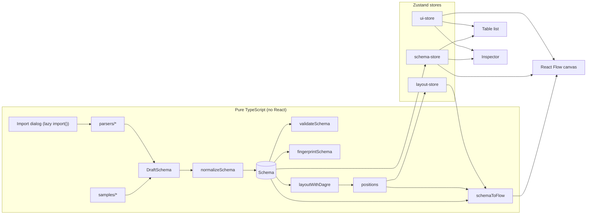

# Architecture

SchemaFlow is a static, client-only Next.js app. A schema (a built-in sample, or SQL/Prisma
imported through the Import dialog) is normalized into one in-memory `Schema` model, from which the React Flow diagram, the
table list and the inspector are derived. Nothing is sent to a server and imported SQL is never
executed.

## Decision index

One line per ADR; the full records are under [Decision records](#decision-records) below.

| ADR                                                                                                                                      | Date       | Decision                                                                                                           | Reason                                                                                                 | Alternatives rejected                                                           |
| ---------------------------------------------------------------------------------------------------------------------------------------- | ---------- | ------------------------------------------------------------------------------------------------------------------ | ------------------------------------------------------------------------------------------------------ | ------------------------------------------------------------------------------- |
| [ADR-001](#adr-001--tailwind-via-tailwindcsspostcss-2026-11-13)                                                                          | 2026-11-13 | Tailwind via `@tailwindcss/postcss`                                                                                | Matches the bundled Next docs and spec; works with Turbopack and webpack                               | Turbopack-specific loader                                                       |
| [ADR-002](#adr-002--static-export-cache-components-disabled-2026-11-13)                                                                  | 2026-11-13 | Static export, Cache Components off                                                                                | App is fully client-side; Cache Components needs the Node runtime                                      | Server build                                                                    |
| [ADR-003](#adr-003--no-vitejsplugin-react-2026-11-13)                                                                                    | 2026-11-13 | No `@vitejs/plugin-react`                                                                                          | Babel peer conflict (ERESOLVE); Vite 8 oxc compiles JSX                                                | —                                                                               |
| [ADR-004](#adr-004--keep-shadcns-cn-package-2026-11-13)                                                                                  | 2026-11-13 | Keep shadcn's `cn` package                                                                                         | One package instead of two                                                                             | Hand-written `cn` with clsx + tailwind-merge                                    |
| [ADR-005](#adr-005--stay-on-typescript-5x-and-eslint-9x-2026-11-13)                                                                      | 2026-11-13 | Stay on TypeScript 5.x / ESLint 9.x                                                                                | `eslint-config-next` and the Next type-check target these majors                                       | TypeScript 7 / ESLint 10                                                        |
| [ADR-006](#adr-006--synthetic-sample-available-in-all-builds-2026-11-13)                                                                 | 2026-11-13 | Synthetic sample in all builds                                                                                     | Performance is only meaningful on a production build; ~70 lines                                        | Dev-only generator                                                              |
| [ADR-007](#adr-007--edge-anchoring-and-handle-sides-2026-11-13)                                                                          | 2026-11-13 | Edge anchoring: source handle left, target right per column                                                        | Edges never cross their own node; little DOM                                                           | Four handles per column; one edge per column pair                               |
| [ADR-008](#adr-008--node-selection-owned-by-ui-store-2026-11-13)                                                                         | 2026-11-13 | Node selection owned by `ui-store`                                                                                 | One source of truth for canvas, list and inspector                                                     | React Flow selection                                                            |
| [ADR-009](#adr-009--rebuilding-react-flow-nodes-only-on-layout-version-changes-2026-11-13)                                               | 2026-11-13 | Rebuild nodes only on layout "version" changes                                                                     | Dragging must not rebuild every node object                                                            | Subscribing to `positions`                                                      |
| [ADR-010](#adr-010--use-dagres-edge-routes-for-long-edges-2026-11-13-qa-001)                                                             | 2026-11-13 | Use Dagre edge routes for long edges                                                                               | Smoothstep ignored intermediate tables (QA-001)                                                        | Edges above nodes; custom obstacle-avoiding router                              |
| [ADR-011](#adr-011--edge-labels-anchored-at-the-fk-row-above-nodes-2026-11-13-qa-002-revised-for-qa-004)                                 | 2026-11-13 | Edge labels anchored at the FK row, above nodes                                                                    | Labels must name the FK and stay readable (QA-002/004)                                                 | Wider `ranksep`; label collision avoidance; labels inside source node           |
| [ADR-011a](#adr-011a--constant-size-edge-labels-and-edge-selection-2026-11-13-qa-005)                                                    | 2026-11-13 | Constant-size, counter-scaled edge labels; edge selection                                                          | Readable at any zoom; edges selectable (QA-005)                                                        | Screen-space overlay with manual projection                                     |
| [ADR-012](#adr-012--hand-written-tolerant-ddl-parser-instead-of-node-sql-parser-2026-11-13)                                              | 2026-11-13 | Hand-written tolerant DDL parser                                                                                   | `node-sql-parser` rejects whole pg_dump tables; 200–300 KB per dialect                                 | node-sql-parser (with rewrites); other single-dialect or WASM libraries         |
| [ADR-013](#adr-013--hand-written-prisma-schema-parser-instead-of-mrleeboprisma-ast-2026-11-16)                                           | 2026-11-16 | Hand-written Prisma parser                                                                                         | `@mrleebo/prisma-ast` needs fs/os shims, throws on first error, no locations                           | `@mrleebo/prisma-ast`                                                           |
| [ADR-014](#adr-014--import-dialog-lazy-parsers-on-the-main-thread-no-web-worker-2026-11-16)                                              | 2026-11-16 | Import dialog: lazy parsers on the main thread                                                                     | Parse cost small (~1 MB SQL in 99–144 ms); 5 MB cap                                                    | Web Worker                                                                      |
| [ADR-015](#adr-015--issues-panel-docked-under-the-canvas-errors-open-it-2026-11-16)                                                      | 2026-11-16 | Issues panel docked under canvas; errors open it                                                                   | Visible without covering the diagram; sheet below md                                                   | `issuesPanelDismissed` flag                                                     |
| [ADR-016](#adr-016--own-search-palette-instead-of-shadcn-command--cmdk-2026-11-16)                                                       | 2026-11-16 | Own search palette                                                                                                 | cmdk has no windowing, weak `table.column` ranking, new dependency                                     | shadcn `command` (cmdk)                                                         |
| [ADR-017](#adr-017--inspector-three-tabs-explicit-vs-reading-navigation-2026-11-16)                                                      | 2026-11-16 | Inspector: three tabs; explicit vs. reading navigation                                                             | Four labelled tabs truncate at 240 px                                                                  | Four tabs                                                                       |
| [ADR-018](#adr-018--neighbourhood-highlighting-and-inert-panels-2026-11-16)                                                              | 2026-11-16 | Neighbourhood highlighting and inert panels                                                                        | Focus set derived outside reducers keeps `ui-store` schema-free                                        | Not recorded                                                                    |
| [ADR-019](#adr-019--real-world-dumps-partitions-folded-schema-qualified-names-2026-11-16-p2-t10)                                         | 2026-11-16 | Fold partitions; schema-qualified names                                                                            | GitLab `structure.sql` has 434 partitions among 1,426 tables                                           | Not recorded                                                                    |
| [ADR-020](#adr-020--error-boundaries-per-region-app-level-error-pages-build-time-qa-hooks-2026-11-16-p2-t10)                             | 2026-11-16 | Error boundary per region; app error pages; build-time QA hooks                                                    | A render error must not take down the app; hooks stay out of `out/`                                    | Not recorded                                                                    |
| [ADR-021](#adr-021--phone-table-list-sheet-enter-on-resize-separators-2026-11-16-p2-t10)                                                 | 2026-11-16 | Phone table-list sheet; Enter on resize separators                                                                 | A 200 px list cannot fit beside the minimum canvas at 390 px                                           | 0 px side panel                                                                 |
| [ADR-022](#adr-022--large-schema-frame-costs-2026-11-16-p2-t10)                                                                          | 2026-11-16 | Large-schema frame costs                                                                                           | Profiles of panning and centring on 2,000 tables                                                       | Not recorded                                                                    |
| [ADR-023](#adr-023--real-input-selection-costs-lighter-zoomed-out-canvas-edge-dimming-packed-layout-deferred-2026-11-19-p2-t10-round-12) | 2026-11-19 | Superseded by ADR-031. Real-input costs, lighter zoomed-out canvas, edge dimming; packed layout deferred           | Synthetic clicks hid pointerdown cost; group opacity was slow                                          | Packing pass now (fitted view too heavy); hiding edges while moving             |
| [ADR-024](#adr-024--committed-playwright-e2e-suite-2026-11-19-e2e-01)                                                                    | 2026-11-19 | Committed Playwright e2e suite                                                                                     | Repeatable, real-input checks for every handoff; dev-only dependency                                   | Ad-hoc CDP harnesses                                                            |
| [ADR-025](#adr-025--layout-persistence-per-fingerprint-localstorage-keys-2026-11-19-p3-t01)                                              | 2026-11-19 | Layout persistence in localStorage (per-fingerprint keys, LRU 20)                                                  | P3-T01                                                                                                 |
| [ADR-026](#adr-026--collapse-modes-ui-positions-kept-mouse-toggle--keyboard-inspector-control-2026-11-19-p3-t02)                         | 2026-11-19 | Collapse modes UI: positions kept, mouse toggle + inspector control, bulk actions                                  | P3-T02                                                                                                 |
| [ADR-027](#adr-027--image-export-own-svg-renderer-instead-of-html-to-image-2026-11-19-p3-t03)                                            | 2026-11-19 | Image export: own SVG renderer, no `html-to-image`                                                                 | P3-T03                                                                                                 |
| [ADR-028](#adr-028--text-generators-sql-prisma-mermaid-json-with-warnings-and-fixed-point-tests-2026-11-19-p3-t04)                       | 2026-11-19 | Text generators (SQL ×3, Prisma, Mermaid, JSON): warnings, mapping, fixed-point tests                              | P3-T04                                                                                                 |
| [ADR-029](#adr-029--one-export-dialog-with-tabs-preview-and-stale-safe-generation-2026-11-19-p3-t05)                                     | 2026-11-19 | One Export dialog: text + image tabs, capped preview, revision-keyed cache, gesture-safe copy / download           | P3-T05                                                                                                 |
| [ADR-030](#adr-030--session-restore-indexeddb-source-text-re-parsed-on-load-2026-11-19-p3-t06)                                           | 2026-11-19 | Session restore: last import in IndexedDB, re-parsed on load; `?sample=` wins; one-shot viewport; Clear saved data | P3-T06                                                                                                 |
| [ADR-031](#adr-031--packed-layout-300-table-design-target-no-canvas-overview-2026-11-20-p3-t07)                                          | 2026-11-20 | Packed layout for elongated large schemas; ~300-table design target; no canvas overview                            | Tall GitLab layout (242,000 px) is unusable; overview renderer dropped by scope decision               | Canvas overview renderer (designed, not built)                                  |
| [ADR-032](#adr-032--focus-anchor-after-in-inspector-navigation-2026-11-20-p3-t08)                                                        | 2026-11-20 | Focus moves to the inspector title after Relations/Back navigation                                                 | QA-027/028: the activated button unmounts, focus fell to `body`                                        | Focusing the store action (DOM in stores)                                       |
| [ADR-033](#adr-033--postgresql-expressions-in-mysql-and-sqlite-exports-2026-11-20-bb-p3)                                                 | 2026-11-20 | CHECKs and defaults from PostgreSQL are rewritten for MySQL/SQLite when safe, otherwise left out with one warning  | QA-031: GitLab → SQLite failed on `char_length`, `::` casts, `~`                                       | Copying verbatim and warning only; a full SQL expression translator             |
| [ADR-034](#adr-034--schema-health-checks-in-a-second-bottom-panel-tab-2026-11-21-p4-t01)                                                 | 2026-11-21 | Pure advisory checks in `src/analysis`, shown in a Health tab beside Issues                                        | P4-T01: findings are advice, not import problems                                                       | Mixing them into `ImportIssue`; a new toolbar button                            |
| [ADR-035](#adr-035--path-finder-in-an-inspector-tab-2026-11-23-p4-t02)                                                                   | 2026-11-23 | Shortest undirected FK path in a pure `findPath`, shown in an inspector Path tab and highlighted on the canvas     | P4-T02: no new toolbar button (390 px width); one path, no all-paths mode                              | A toolbar mode; a bottom-panel tab; listing every path                          |
| [ADR-036](#adr-036--subject-areas-derived-and-hidden-on-the-canvas-2026-11-23-p4-t03)                                                    | 2026-11-23 | Subject areas derived from schema names or name prefixes; hiding an area hides its tables and edges in place       | P4-T03: no relayout, no editing, session only                                                          | Editable areas; relayout on hide; dimming only                                  |
| [ADR-037](#adr-037--commands-in-the-own-palette-and-one-shortcut-table-2026-11-23-p4-t04)                                                | 2026-11-23 | Commands live in the ⌘K search dialog; one `SHORTCUTS` table feeds the key handler, the help dialog and hints      | P4-T04: no new dependency (ADR-016 stands); palette, keys and help cannot drift                        | cmdk; separate command palette; hand-written help                               |
| [ADR-038](#adr-038--accessibility-audit-with-axe-2026-11-24-p4-t06)                                                                      | 2026-11-24 | Automated axe audit of the main screens; skip link; SchemaFlow `ariaLabelConfig`; edges stay unfocusable           | P4-T06: one dev dependency, `@axe-core/playwright` 4.11.3; contrast and names cannot regress unnoticed | jest-axe in jsdom (no layout, no contrast); manual-only checks; focusable edges |

## Data flow

1. `src/app/page.tsx` (server component, static) renders the client `Workspace`.
2. On mount, `Workspace` reads `?sample=…` from `window.location.search`, builds the sample and
   calls `schema-store.loadSchema()`. `layout-store` computes Dagre positions for the schema's
   fingerprint if none exist.
3. `SchemaCanvas` derives nodes/edges with `schemaToFlow()` when the schema, collapse modes or a
   layout "version" (re-layout / reset) changes. Between those events, React Flow owns transient
   node state (`applyNodeChanges`) and drag-stop writes the final position back to `layout-store`.
4. **Import** (P2-T05): the toolbar's `ImportDialog` lazy-loads `@/parsers` (a separate chunk),
   decodes a file with `decodeSchemaFile` (UTF-8/UTF-16, binary rejected; 5 MB cap checked first)
   and previews `parseSchemaText()` results. Confirming calls `applyImportedSchema()`:
   `loadSchema` → `ensureLayout` (reused for a known fingerprint) → `clearSelection()` and an empty
   table filter.
5. **Issues** (P2-T06): `ImportIssue` carries an optional `table` (the raw name a parser saw)
   and `tableId`. `normalizeSchema` sets `tableId` for its own issues and resolves `table` →
   `tableId` (case-insensitive, like all name lookups), so issues can link to the canvas. The
   imported text is kept in `schema-store.sourceText` (≤ 5 MB, not part of the schema or its
   fingerprint) for source excerpts; only the expanded excerpt component reads it.
6. **Search** (P2-T07, ADR-016): `src/domain/search` builds an index per `Schema` object (cached
   in a `WeakMap`) and ranks tables and columns. The toolbar `SearchDialog` (open state
   `ui-store.searchOpen`, also opened by ⌘K / Ctrl+K / `/`) mounts `SearchPanel` only while
   open. Choosing a result calls `revealTable(tableId, columnId?)` (`src/stores/reveal.ts`, shared
   with the issues panel's **Show table**): it clears a table-list filter that hides the table,
   selects it, sets `ui-store.highlightedColumn`, and issues a focus request that the canvas
   centers on the table, or on the column's row (`rowCenterOffset`). A new import or sample calls
   `resetForNewSchema()`, which clears the selection, filter and highlight and closes search.
7. **Inspector** (P2-T08): `getTableDetails(schema, tableId)` (`src/domain/schema/table-details.ts`,
   pure) turns a table into display-ready columns (default labels, enum values, FK targets),
   keys, checks and resolved relationships, using a relationship index built once per schema
   (`WeakMap`). The inspector shows it in three tabs (`ui-store.inspectorTab`). Every jump goes
   through `revealTable(tableId, columnId?, { mode, tab })`: links and search center the canvas
   (`mode` "center"), a click on an inspector column row only pans when the row is off-screen
   ("ensure-visible"), and Relations navigation keeps the Relations tab and records
   `inspectorBack` (table + tab). Below `md` the inspector is an overlay sheet.
8. Selection lives in `ui-store` (`selectedTableId`). `TableNode` and `RelationshipEdge` subscribe
   with a boolean selector (`s.selectedTableId === id`), so a selection change re-renders only the
   affected node(s)/edges — the nodes array is not rebuilt.
9. **Neighbourhood highlighting** (P2-T09, ADR-018): `useFocusSetSync` (mounted by the canvas)
   subscribes to the schema, `selectedTableId` and the `neighbourhoodDepth` setting and writes
   `ui-store.focusSet = getFocusSet(schema, selected, depth)` (pure, `selectors.ts`; adjacency
   cached per schema). Nodes and edges read one boolean each (`dimmed`), so only elements whose
   state flips re-render.

## Module boundaries

| Path                                 | Responsibility                                                                                                                   | May import                   |
| ------------------------------------ | -------------------------------------------------------------------------------------------------------------------------------- | ---------------------------- |
| `src/domain/schema`                  | Types, IDs, normalize, validate, fingerprint, selectors                                                                          | nothing app-specific         |
| `src/domain/search`                  | Search index and ranking (P2-T07)                                                                                                | domain                       |
| `src/samples`                        | E-commerce sample, synthetic generator, `?sample=` parsing                                                                       | domain                       |
| `src/graph`                          | `schemaToFlow`, Dagre layout, node metrics, handle IDs                                                                           | domain, `@xyflow` types only |
| `src/stores`                         | Zustand slices                                                                                                                   | domain, graph                |
| `src/components`                     | React UI (`workspace/`, `canvas/`, `errors/`, `ui/` = shadcn)                                                                    | everything above             |
| `src/parsers` (P2)                   | SQL / Prisma → `DraftSchema`                                                                                                     | domain                       |
| `src/analysis` (P4)                  | Health checks (P4-T01: `analyzeSchema`, ADR-034)                                                                                 | domain                       |
| `src/domain/schema/path.ts` (P4)     | `findPath`: shortest undirected FK path between two tables (P4-T02, ADR-035)                                                     | pure                         |
| `src/analysis/subject-areas.ts` (P4) | `getSubjectAreas`: derives subject areas from schema names or table-name prefixes (P4-T03, ADR-036)                              | domain                       |
| `src/generators` (P3)                | Diagram SVG + raster sizing (P3-T03); SQL / Prisma / Mermaid / JSON text (P3-T04); Export dialog in `components/export` (P3-T05) | domain, graph (pure)         |

Rules: pure modules have zero React/Next/DOM imports and are unit-tested; parsers never import
React Flow; canvas components never import parsers. `src/graph` imports only _types_ from
`@xyflow/react`.

## Data model

Defined in `src/domain/schema/types.ts`, following the Phase 1 spec with these refinements:

- `ImportResult` is a discriminated union on `ok` (`ok: true` guarantees `schema`).
- Named helper types (`DataType`, `KeyConstraint`, `TableIndex`, `CheckConstraint`,
  `RelationshipEnd`, `EnumType`, `CollapseMode`, `LayoutDirection`, `Viewport`) instead of inline
  object types.
- `Column.isUnique` means "covered alone by a unique constraint or unique index" (PK excluded).
- PK columns are forced `nullable: false` during normalization.
- `DraftSchema` (`draft.ts`) is the importer contract: string names, optional inline `references`,
  table-level `foreignKeys`, detached `foreignKeys`/`indexes` (ALTER TABLE / CREATE INDEX) and
  `defaultSchemaName` (e.g. `public`).

`normalizeSchema(draft)`:

- IDs: `tableId = schema ? "schema.name" : "name"`, `columnId = "<tableId>.<column>"`,
  `relationshipId = "fk:<from>(<cols>)-><to>"` (suffixed `#2…` if duplicated).
- Names resolve case-insensitively (`NameLookup`). An explicit schema must match exactly; otherwise
  the default schema is tried, then the bare name. Names that differ only in case are ambiguous.
- Unresolved tables/columns, missing target PKs and column-count mismatches become `warning`
  issues and the relationship is skipped. Duplicate/empty table names are `error`s (table skipped).
  Nothing throws for user data.
- `cardinality = one-to-one` when the FK column set equals (as a set) the PK, a unique constraint
  or a unique index of the FK table; otherwise `many-to-one`.

`validateSchema(schema)` re-checks invariants (key/id agreement, unique column IDs, ownership,
key columns exist, relationships reference existing tables and their own columns, equal column
counts, `tableOrder` consistency). The sample must produce zero issues.

`fingerprintSchema` hashes sorted, lower-cased `table(columns)` strings with cyrb53
(`sf1-<base36>`): independent of order, types and metadata, so re-importing the same tables
finds the same saved layout (Phase 3).

`selectors.ts`: `getOutgoingRelationships`, `getIncomingRelationships`, `buildAdjacency`,
`getNeighbors(schema, id, depth)` (undirected BFS, excludes the start table).

### Phase 2 import mapping

**SQL** (implemented in P2-T01…T03, hand-written parser, ADR-012). `src/parsers/sql`:

- **Tokenize:** a dialect-aware tokenizer (strings, quoted identifiers, `$tag$` bodies, nested
  comments).
- **Split:** top-level `;` tokens only.
- **Per statement:** each statement is parsed independently.
  - `CREATE TABLE` → `DraftTable`: columns; inline and table-level PK / UNIQUE / CHECK / FK with
    ON DELETE/UPDATE; MySQL `KEY`/`INDEX`.
  - `ALTER TABLE … ADD [CONSTRAINT]` → table patch, or a detached FK.
  - `ALTER COLUMN … SET/DROP DEFAULT`, `SET/DROP NOT NULL` and `ADD GENERATED … AS IDENTITY` →
    column patches.
  - `CREATE [UNIQUE] INDEX` → detached index; expression indexes are skipped with a warning.
  - `CREATE TYPE … AS ENUM` → enum.
- **Defaults** are classified as:
  - literal (casts stripped);
  - function (`name(...)`);
  - expression (`CURRENT_*`, other);
  - autoincrement (serial, identity, `AUTO_INCREMENT`, `AUTOINCREMENT`, `nextval(...)`).
- **Tolerance:** unknown column options are skipped, never fatal.
- **Ignored statements:** `SET`, `SELECT`/`set_config`, `OWNER TO`, `GRANT`/`REVOKE`,
  `COMMENT ON`, sequences, extensions, functions/triggers, schemas, transactions, `DROP`,
  `INSERT`, `PRAGMA`, `USE`, `LOCK` are counted into **one** summary warning.
- **Per-statement warnings with line numbers:** other statements (e.g. `CREATE VIEW`),
  unparseable statements, expression indexes, and FKs to missing tables (from normalize).
- **Result:** the draft goes through the existing `normalizeSchema`/`validateSchema`.
  `parseSql` returns an `ImportResult` and never throws. SQL is treated purely as text and never
  executed.
- **Lazy loading:** the whole `src/parsers` module is loaded with a dynamic `import()` by the
  Import dialog (P2-T05), so it isn't in the initial bundle (ADR-014).
- **Not supported:** `COPY … FROM stdin` data blocks (use a schema-only dump, `pg_dump -s`), MySQL
  `DELIMITER` blocks (reported), and table inheritance or partitions (options ignored).

**Identifier case.** PostgreSQL folds unquoted identifiers to lowercase; MySQL and SQLite
preserve them. SchemaFlow keeps names **as written** (quotes removed) and matches table and column
names **case-insensitively** everywhere (`NameLookup`). As a consequence, two tables that differ
only in case (e.g. quoted `"UserID"` and unquoted `userid`, which PostgreSQL treats as distinct)
collide: the second is reported as `Duplicate table … (names are matched case-insensitively)` and
skipped. This is a deliberate trade-off for predictable lookups; revisit if real schemas need it.

**Prisma** (own parser, ADR-013; `src/parsers/prisma`): lexer (line breaks are tokens; `///`
doc comments kept) → block parser (one logical line per member; line breaks inside `(…)`/`[…]`
continue the line, but a line that starts like a member always starts a new one) → mapping.

- `model` → table (name from `@@map`, schema from `@@schema`); scalar and enum fields → columns
  (name from `@map`); `?` → nullable, otherwise NOT NULL; `[]` scalar lists → array types.
- **Types:** a native `@db.*` type wins (`@db.VarChar(255)` → `varchar(255)`,
  `@db.UnsignedInt` → `int unsigned`, `@db.DoublePrecision` → `double precision`); enum fields use
  the enum's database name (`@@map`); other scalars stay **as written in Prisma** (`String`,
  `DateTime`). We don't guess provider default types, which differ by provider and Prisma version.
  `Unsupported("x")` → `x`.
- `@id`/`@@id` → PK; `@unique`/`@@unique` → unique; `@@index`/`@@fulltext` → indexes (`map` or
  `name` as the key name).
- `@default`: `autoincrement()`/`sequence()` → autoincrement; `dbgenerated("expr")` → expression;
  other calls (`now()`, `uuid()`, `cuid()`) → function; values → literal, as written.
- Relation fields are not columns. `@relation(fields, references, onDelete, onUpdate, map)` → a
  foreign key on that model, with field names resolved to `@map` column names.
- Implicit many-to-many (list relation fields on both sides, neither with `fields`) → join table
  `_AToB` (models sorted by name; `_Name` for a named relation) with `origin: "implicit"`, columns
  `A`/`B` typed like the referenced ids, a unique (A, B) index, an index on B and two
  `prisma-implicit` foreign keys with cascade actions. Needs a single-field `@id` on both models.
- `datasource.provider` sets `source.dialect` (`postgresql`/`postgres`/`cockroachdb`, `mysql`,
  `sqlite`; others → none); PostgreSQL uses `public` as the default schema, like SQL import.
- **Warnings (line-numbered):** unparseable lines, unknown blocks, missing `}`, unterminated
  strings, views (skipped), unknown field types (kept as written), relations with unknown fields.
  Duplicate tables are errors, as for SQL.

## State slices (`src/stores`)

| Store          | Holds                                                                                                                                                                                                                                                                                                                                                                                                                                                                                                                                                                                                                                                                                                                                                                                                                                                                                                                                                                                   |
| -------------- | --------------------------------------------------------------------------------------------------------------------------------------------------------------------------------------------------------------------------------------------------------------------------------------------------------------------------------------------------------------------------------------------------------------------------------------------------------------------------------------------------------------------------------------------------------------------------------------------------------------------------------------------------------------------------------------------------------------------------------------------------------------------------------------------------------------------------------------------------------------------------------------------------------------------------------------------------------------------------------------- |
| `schema-store` | `schema`, `fingerprint`, `issues`; `loadSchema()`; `restoring` (a saved session is being re-parsed, ADR-030)                                                                                                                                                                                                                                                                                                                                                                                                                                                                                                                                                                                                                                                                                                                                                                                                                                                                            |
| `layout-store` | `DiagramLayout` per fingerprint (positions, collapsed, viewport, direction), `version` counter bumped on re-layout. Saved to localStorage per fingerprint (ADR-025).                                                                                                                                                                                                                                                                                                                                                                                                                                                                                                                                                                                                                                                                                                                                                                                                                    |
| `ui-store`     | `selectedTableId`, `tableFilter`, `showMiniMap`, `leftPanelOpen`/`rightPanelOpen`, `focusRequest` (`{ tableId, nonce }`, consumed by the canvas to center a table), `clearRequest` (counter bumped by `clearSelection()` on Escape, which is a `document` keydown listener; the canvas unpins a clicked edge), `issuesPanelOpen` (ADR-015), `searchOpen`/`highlightedColumn` (ADR-016), `inspectorTab`/`inspectorBack` (ADR-017), `neighbourhoodDepth` (a setting) and the derived `focusSet` (ADR-018), `activePath` (the highlighted path; wins over neighbourhood dimming while set; session only; cleared by Escape, Clear and a new schema; ADR-035) `fitRequest` (`{ tableIds, nonce }`, "Show on canvas") and `hiddenAreas` (ids of subject areas hidden on the canvas; session only; cleared by a new schema; ADR-036). `schema-store` also holds `sourceText` (the imported text, for excerpts). Theme preference is owned by `next-themes` (localStorage, class on `<html>`). |

Components use narrow selectors; `useShallow` where a selector returns an object/array.

## Performance strategy

- Nodes carry only `{ tableId, mode }`; components look up the (immutable) table by ID.
- `nodeTypes`/`edgeTypes` are module-scope constants; `TableNode`/`RelationshipEdge` are `memo`ed.
- Selection/highlight are per-component boolean selectors — no nodes-array rebuild on select.
- Positions are written to `layout-store` on drag **stop**, not on every drag frame.
- `onlyRenderVisibleElements` is enabled automatically above 80 tables
  (`LARGE_SCHEMA_THRESHOLD` in `src/components/canvas/schema-canvas.tsx`).
- No animated edges; MiniMap off by default; no continuous animation loops; viewport transitions
  are skipped under `prefers-reduced-motion`.
- Dagre runs synchronously on load/re-layout (~180 ms for 200 tables in Node on an M1).

Profiling guidance: React DevTools → Profiler → "Highlight updates when components render".
Selecting a table should re-render only the previously and newly selected `TableNode`s, their
connected `RelationshipEdge`s, the inspector and the matching list items. Panning/zooming should
re-render no `TableNode`.

## Chosen versions (2026-11-13)

| Package                                              | Version                  | Notes                                                             |
| ---------------------------------------------------- | ------------------------ | ----------------------------------------------------------------- |
| next                                                 | 16.4.6                   | App Router, Turbopack, `output: "export"`                         |
| react / react-dom                                    | 19.3.0                   |                                                                   |
| typescript                                           | 5.x (`^5`)               | as pinned by create-next-app; TS 7 not yet adopted (ADR-005)      |
| tailwindcss / @tailwindcss/postcss                   | 4.3.5                    | CSS-first config in `globals.css`                                 |
| shadcn (CLI, dev)                                    | 4.23.0                   | style `radix-nova`, base `radix`                                  |
| radix-ui                                             | 1.8.x                    | single-package Radix primitives used by shadcn                    |
| cn                                                   | 0.5.x                    | shadcn's compiled `clsx` + `tailwind-merge` replacement (ADR-004) |
| lucide-react                                         | 1.72.x                   | icons                                                             |
| react-resizable-panels                               | 4.22.x                   | via shadcn `resizable`                                            |
| @xyflow/react                                        | 12.12.1                  | base stylesheet imported in `globals.css`                         |
| zustand                                              | 5.1.0                    |                                                                   |
| @dagrejs/dagre                                       | 3.1.3                    | ESM, named `Graph`/`layout` exports                               |
| next-themes                                          | 0.4.6                    | class strategy                                                    |
| vitest / @vitest/coverage-v8                         | 5.1.0                    | Vite 8, JSX via built-in oxc transform                            |
| jsdom                                                | 31.0.1                   |                                                                   |
| @testing-library/react / user-event / jest-dom / dom | 16.3 / 14.6 / 7.0 / 10.4 |                                                                   |
| eslint / eslint-config-next                          | 9.x / 16.4.6             | flat config; `next lint` no longer exists                         |
| prettier / prettier-plugin-tailwindcss               | 3.10.1 / 0.8.1           |                                                                   |

No SQL or Prisma parser dependency (ADR-012, ADR-013). No image-export dependency either: PNG and SVG
are drawn by our own renderer (ADR-027), so `html-to-image` is not installed.

## Decision records

### ADR-001 — Tailwind via `@tailwindcss/postcss` (2026-11-13)

- **Decision:** Use `@tailwindcss/postcss` with `postcss.config.mjs`.
- **Context:** create-next-app 16.4 scaffolds a Turbopack-specific `@tailwindcss/turbopack` loader;
  the Next.js docs bundled in `node_modules/next/dist/docs` and the project spec use PostCSS.
- **Alternatives:** Turbopack loader (bundler-specific, less widely documented).
- **Consequences:** Works with Turbopack and webpack; shadcn CLI detected Tailwind v4 correctly.

### ADR-002 — Static export, Cache Components disabled (2026-11-13)

- **Decision:** `output: "export"`; removed the scaffold's `cacheComponents`/`partialPrefetching`.
- **Context:** The app is fully client-side. Cache Components "requires the Node.js runtime"
  (bundled docs), which conflicts with a static export.
- **Alternatives:** Keep a server build (unnecessary hosting requirements).
- **Consequences:** `npm run build` emits `out/`; `npm run start` serves it with
  `python3 -m http.server` (no extra npm dependency). No server actions, route handlers or
  request-time APIs may be used. Query params are read on the client in an effect.

### ADR-003 — No `@vitejs/plugin-react` (2026-11-13)

- **Decision:** Run Vitest without the React plugin; JSX is compiled by Vite 8's built-in oxc
  transform (`oxc.jsx.runtime = "automatic"`).
- **Context:** `@vitejs/plugin-react@6.3` has optional Babel 8 peers that conflict with shadcn's
  Babel 7 tooling (npm ERESOLVE). Fast Refresh is irrelevant for tests.
- **Consequences:** One fewer dependency; component tests opt into jsdom per file.

### ADR-004 — Keep shadcn's `cn` package (2026-11-13)

- **Decision:** Keep `cn` (maintained by shadcn, repo shadcn-ui/cn) which shadcn 4.23 installs in
  place of `clsx` + `tailwind-merge`.
- **Alternatives:** Hand-written `cn` with `clsx` + `tailwind-merge` (two packages instead of one).
- **Consequences:** `src/lib/utils.ts` re-exports `cn`; generated components import from `cn`.

### ADR-005 — Stay on TypeScript 5.x and ESLint 9.x (2026-11-13)

- **Decision:** Keep the versions create-next-app pins (`typescript@^5`, `eslint@^9`).
- **Context:** TypeScript 7.0 and ESLint 10 are published, but `eslint-config-next@16.4.6`
  and the Next build's type-check integration target the pinned majors.
- **Consequences:** Revisit when `eslint-config-next` declares support (Phase 4 maintenance).

### ADR-006 — Synthetic sample available in all builds (2026-11-13)

- **Decision:** `/?sample=synthetic&tables=N&seed=S` works in dev and production builds.
- **Context:** The spec calls the generator dev-only, but performance is only meaningful on a
  production build. The code is ~70 lines with no dependencies.
- **Consequences:** Documented as a testing aid; table count clamped to 1–1000.

### ADR-007 — Edge anchoring and handle sides (2026-11-13)

- **Decision:** Each column row has a `source` handle on its **left** edge and a `target` handle on
  its **right** edge; Dagre edges run parent → child, so referenced tables sit to the left in LR.
  Composite FKs draw one edge anchored at the first column pair (label lists all pairs).
  Self-references draw a loop on the left side of the node.
- **Alternatives:** Four handles per column with side switching (more DOM, more complexity);
  one edge per column pair (visual noise).
- **Consequences:** Edges never cross their own node in LR layout (see ADR-010 for routing around other nodes). In TB layout edges still use
  side handles. Columns hidden by a collapse mode fall back to header handles.

### ADR-008 — Node selection owned by `ui-store` (2026-11-13)

- **Decision:** Nodes are `selectable: false` in React Flow; clicks/Enter set
  `ui-store.selectedTableId`, and nodes read it with a boolean selector.
- **Context:** Keeps a single source of truth shared by canvas, list and inspector, and avoids
  rewriting the nodes array to sync selection.
- **Consequences:** React Flow's multi-select/box-select are not used in Phase 1. Edges remain
  natively selectable for hover/selected emphasis.

### ADR-009 — Rebuilding React Flow nodes only on layout "version" changes (2026-11-13)

- **Decision:** `SchemaCanvas` derives nodes with `useMemo` keyed on `schema`, `fingerprint`,
  `collapsed` and `layout-store.version`, reading positions via `getState()`. Between rebuilds,
  React Flow owns node state (`applyNodeChanges`), synced with the "adjust state during render"
  pattern (no `setState` in effects). Drag stop writes positions back to `layout-store` without
  bumping `version`.
- **Context:** Subscribing to `positions` would rebuild all node objects after every drag stop,
  re-rendering every `TableNode`.
- **Consequences:** One documented lint exception: `react-hooks/exhaustive-deps` is disabled on that
  single `useMemo` because `version` is an intentional trigger that the memo body does not read.
  This is the only lint suppression in the codebase.

### ADR-010 — Use Dagre's edge routes for long edges (2026-11-13, QA-001)

- **Decision:** Dagre runs as a multigraph (one edge per relationship). For LR layouts, edges that
  span more than one rank keep Dagre's interior waypoints (`DiagramLayout.edgeRoutes`). They render
  as a cubic path with horizontal tangents through those waypoints, but only while both end tables
  are still at the positions recorded with the route. Otherwise the edge uses smoothstep.
- **Context:** Cowork found QA-001: smoothstep ignores intermediate tables, so long edges were
  drawn behind unrelated nodes.
- **Alternatives:** Draw edges above nodes (lines across tables); a custom obstacle-avoiding
  router (too heavy for Phase 1).
- **Consequences:** Dragging a table drops the route for its edges until the next "Layout".
  Moving an _intermediate_ table is not detected, so a route may then cross it. TB layouts have no
  routes. `RelationshipEdge` subscribes to its two end nodes via `useInternalNode`.

### ADR-011 — Edge labels anchored at the FK row, above nodes (2026-11-13, QA-002; revised for QA-004)

- **Decision:** On-canvas labels for emphasized edges show `fk_cols → table.cols`, are anchored just
  outside the FK handle, and use `z-index: 1001` so nodes never clip them. The constraint name stays
  in the hover tooltip.
- **Revision (QA-004):** Showing labels for every edge of the selected table covered neighbouring
  tables, because rank gaps (~110 px) are narrower than labels (up to ~200 px). Labels now appear
  only for the **hovered** or **clicked** edge, one at a time, with the full description (constraint
  name included). The native SVG `<title>` was removed to avoid a duplicate tooltip; edges carry the
  same text as their accessible name. Edges of the selected table are still highlighted.
- **Alternatives considered:** a wider `ranksep` (sparser diagrams, still fails for long names);
  label collision avoidance (complex); labels inside the source node (hides that node's content).
- **Consequences:** Edges are now local React Flow state with `onEdgesChange`, so click-selection
  works. Before this fix, edge clicks were silently ignored because edges were passed as fixed props
  without a change handler, which contradicted ADR-008's "edges remain natively selectable". Non-routed
  edges use the same horizontal-tangent curve as routed ones, for a consistent look.

### ADR-011a — Constant-size edge labels and edge selection (2026-11-13, QA-005)

- **Decision:** Labels are counter-scaled with `scale(1/zoom)` (`labelTransform` in
  `src/graph/edge-path.ts`), so they keep a constant screen size and a 12 px screen gap from the FK
  handle. Only the visible `EdgeLabel` subscribes to zoom; edges without a label don't re-render
  on zoom.
- **Edge selection:** edges have three states (default, highlighted, selected), exposed as
  `data-edge-state`. Selecting a table clears a clicked edge, via a `ui-store` subscription for
  selection and focus-request changes plus direct calls in node-click and Enter handlers, which
  also cover re-selecting the same table.
- **Alternatives:** a screen-space overlay (it would need manual projection of every label
  position on pan); counter-scaling is simpler and keeps React Flow's positioning.

### ADR-012 — Hand-written tolerant DDL parser instead of node-sql-parser (2026-11-13)

- **Decision:** Parse SQL DDL with a small, dependency-free parser in `src/parsers/sql`
  (≈1,190 code lines). This was the **user's decision** after the escalation below.
- **Context (probe, read-only, in scratch):** `node-sql-parser@5.4.0` (latest; Apache-2.0; runtime
  dependency `big-integer`).
  - Dialect builds are 301 KB (PostgreSQL), 270 KB (MySQL) and 201 KB (SQLite) minified, vs 2.4 MB
    for the all-dialect `index.js`; about 92 MB unpacked in total.
  - MySQL and SQLite DDL parsed fine.
  - The PostgreSQL build rejects the **whole** `CREATE TABLE` on: unquoted user-defined or enum
    column types (`status order_status`, `status public.order_status`; only a bare quoted name
    works); `GENERATED ALWAYS AS IDENTITY`; and `REFERENCES t` without a column list. All three
    are standard in pg_dump output, and the e-commerce fixture needs enum columns.
- **Alternatives:**
  - Pre-parse rewrites plus retry-on-error around node-sql-parser: brittle, and undeclared types
    such as `citext` would still drop tables.
  - Other libraries: single-dialect, or a large WASM build.
- **Consequences:**
  - No parser dependency and no 200–300 KB dialect bundles.
  - Tolerant by design: unknown column options are skipped, and a bad statement is skipped with
    a line-numbered warning.
  - We own correctness. This is covered by 5 fixtures, unit tests, seeded robustness tests and a
    1 MB performance test (~0.1 s).

### ADR-013 — Hand-written Prisma schema parser instead of @mrleebo/prisma-ast (2026-11-16)

- **Decision:** Parse Prisma schemas with a small, dependency-free parser in `src/parsers/prisma`
  (926 lines, ≈820 code lines). This was the **user's decision** after the escalation below.
- **Context (probe, read-only, in scratch):** `@mrleebo/prisma-ast@0.16.0` (latest; MIT;
  dependencies `chevrotain@^12`, `lilconfig@^2`).
  - At **import time** it runs `lilconfigSync("prisma-ast").search()` (a filesystem search for a
    config file) and imports Node's `os`. A browser bundle (esbuild, `--platform=browser`) fails on
    `fs`, `path` and `os`; using it would need bundler aliases that stub `lilconfig` and `os`.
  - With those stubbed: about 119 KB minified / 33 KB gzip (mostly chevrotain).
  - Every version since 0.7 depends on `lilconfig`; only the old 0.5.2 doesn't.
  - All-or-nothing: the first syntax error throws, so one bad line fails the whole import.
  - Source locations are off by default (`nodeLocationTracking: "none"`), configurable only via the
    config file or a custom parser instance.
- **Consequences:**
  - No dependency, no bundler shims.
  - Tolerant like the SQL parser: a bad line or block is skipped with a line-numbered warning.
  - We own correctness: 3 fixtures, unit tests, seeded robustness tests (360 truncations and
    corruptions plus 400 random inputs) and a 500-model performance test (57–118 ms in Node, M1).
  - **Size:** larger than the 350–450 lines estimated when the option was offered (926 lines,
    Prettier-formatted). The block parser and the mapping (relations, implicit many-to-many) are
    each about 350 lines.

### ADR-014 — Import dialog: lazy parsers on the main thread, no Web Worker (2026-11-16)

- **Decision:** parse imports on the main thread, with `@/parsers` loaded by a dynamic `import()`
  when the dialog opens. Parsing runs after one `setTimeout(0)`, so "Parsing…" paints first.
  Inputs over **5 MB** are refused before being read.
- **Context:** measured parse cost is small: ~1 MB of SQL in 99–144 ms, and a 500-model Prisma
  schema in 57–118 ms (Node, M1), so 5 MB is about 0.75 s worst case. The dominant cost after
  import is the Dagre layout, which already runs on the main thread and which a parse worker
  wouldn't move. A worker would add a message protocol, a second bundle entry and jsdom test gaps.
- **Evidence (static build, `out/index.html`):**
  - Before (`8f5afbc`): 8 initial chunks, 1,069,890 B raw / 338,645 B gzip, with no parser code.
  - After (`f874d46`): 9 initial chunks, 1,087,080 B raw / 343,877 B gzip (+17 KB / +5 KB for the
    dialog UI).
  - Parsers (SQL + Prisma): chunk `2h8w4ivmr4jd6.js`, 35,611 B raw / 12,146 B gzip. It is not
    referenced by `index.html`, only by name from the app chunk's dynamic-import loader.
- **Related rules:**
  - Files are decoded by BOM (UTF-16 LE/BE, else UTF-8); gzip/zip magic or NUL characters are
    refused as binary.
  - The picker has no `accept` filter: detection decides.
  - Large content never lives in a controlled textarea: files, and pastes over 1 MB, are shown as
    a card.
  - Import is allowed with at least one table even when there are errors.
  - Import replaces the diagram (no undo until Phase 3), which the dialog states inline.
- **Revisit:** move parsing to a worker if real files approach the cap and the parse becomes
  noticeable.

### ADR-015 — Issues panel docked under the canvas; errors open it (2026-11-16)

- **Decision:**
  - The issues panel is a collapsible bottom panel in a vertical split around the canvas. Below
    `md` (768 px) it is a bottom sheet over the canvas: same component, same test ids.
  - An import **with errors** opens it. Any other import leaves it as it is, so a panel the user
    closed stays closed after a warnings-only import, and an open panel isn't auto-closed by a
    clean import (it shows its empty state).
  - Escape keeps its meaning (clear the selection).
- **Why not a dismissed flag:** the plan had an `issuesPanelDismissed` flag. The rule above
  already gives the requested behaviour, so the flag would be dead state.
- **Layout details found while building it:**
  - **Percentage minimums** (diagram ≥ 30%, issues ≥ 15%). With pixel minimums, a group too
    short for them made the library fall back to a 50/50 split.
  - **Panel state changes only from the user's separator interaction** (pointer or keyboard on
    the handle). Any other resize the library makes is corrected once back to the stored state,
    so the panel never opens or closes by itself.
  - **Fit after import uses the final canvas size.** An error import opens the panel in the same
    update, and React Flow learns the smaller size a few frames later. So canvas size changes
    within 600 ms of a new layout re-fit (via a store subscription, with no re-render). Later
    resizes, such as the user opening, closing or dragging the panel, keep the viewport.
  - **The sheet doesn't resize the canvas** (it overlays it), so that re-fit can't help on
    phones. Instead, every fit (the import fit and Reset view) uses a bottom padding of 65% of
    the canvas height while the sheet is open, so the diagram lands in the area above the 60%
    sheet (QA-014). Opening the sheet later by hand still keeps the viewport.
    "Show table" / search reveals use the same rule (QA-039, P4-T07): the target is centred in the
    band above the sheet, measured from the DOM (the sheet is 60% of the viewport, the pane sits
    below the toolbar); a table taller than the band is top-aligned instead.
  - **Toolbar tooltips and dialogs:** a dialog returns focus to its trigger on close, which
    opened the trigger's tooltip and left it showing (QA-015). `useReturnFocusTooltip` ignores
    that one returning focus; hover and keyboard focus still open it.
  - The Issues button is disabled only when there are no issues **and** the panel is closed, so
    an open empty panel can still be closed from the toolbar.
- **Limits:**
  - 500 rows are rendered at a time ("Show 500 more").
  - Excerpt lines are cut at 400 characters, so a minified single-line dump stays cheap.
  - The line index is built once per source.
  - Copy uses the Clipboard API (secure context), else `execCommand("copy")`, else it shows the
    text for manual selection.
- **Bundle:** +11.8 KB raw / +3.0 KB gzip initial JS (initial chunks 1,099,225 B raw / 346,959 B
  gzip at `62ba31d`). The parsers stay lazy (chunk `2s-fxisvw7v--.js`, not referenced by
  `index.html`).

### ADR-016 — Own search palette instead of shadcn `command` / cmdk (2026-11-16)

- **Decision:** search is our own pure index and ranking (`src/domain/search`) with a Radix
  Dialog and the WAI-ARIA combobox/listbox pattern. No new dependency. The ROADMAP had named
  shadcn `command` (cmdk).
- **Why not cmdk:**
  - It renders and scores every item on each keystroke, with no windowing; a 2,000-table schema
    has about 40,000 columns.
  - Its fuzzy ranking doesn't know `table.column` or snake_case / camelCase segments.
  - It would be a new dependency.
- **Ranking:** case-insensitive tiers per term: exact, prefix, segment prefix, substring, then a
  segment-anchored fuzzy subsequence (terms of 3+ characters; every run of matched characters
  starts at a segment start, so `uid` → `user_id` but not `unit_price_cents`). Names are also
  compared without spaces, `_` and `-` at the same tier, so `createdAt` finds `created_at`.
  Ties: the sum of tiers, the shorter name, declaration order.
- **Query syntax:** one term matches the primary field (table name / column name); several
  space-separated terms are ANDed over schema / table / column with one on the primary field;
  dotted queries are positional from the right (`ord.user`, `billing.inv`, `orders.`).
- **Schema names** are shown unless they are the source default (none, or `public` on
  PostgreSQL).
- **Performance:**
  - Prepared names are shared per distinct name.
  - Schema and table matches are memoized per query.
  - Each group keeps only its best 50 in a bounded insertion list.
  - Results follow a `useDeferredValue` of the query.
  - 2,000 × 20 with every column name distinct (test, alone): index about 80–90 ms, queries 7–25 ms (first, unwarmed runs).
  - In headless Chrome on the production build, with the 2,000 × 20 fixture
    (`tests/fixtures/large/search-2000.postgres.sql`): 31–61 ms from input to painted results.
- **Found while building it:** the wall-clock budgets (this one and the parser ones) failed when
  run alongside 40 other test files on this 8 GB machine, measuring contention. Files named
  `*performance.test.ts` now run in their own Vitest project after the others, one at a time
  (`vitest.config.mts`); the budgets are unchanged.
- **Revealing a column:** the canvas centers on the row. If a collapse mode (P3-T02) would hide
  it, the node still renders that row (marked) while it is highlighted.
- **Phone toolbar:** Layout, Theme and Settings move into one **More** menu below `sm`, so new
  toolbar buttons don't overflow 390 px again (QA-012 twice).
  `scripts/headless/toolbar-width.mjs` checks this against a running server.
- **Bundle:** +16.1 KB raw / +4.5 KB gzip initial JS (1,115,374 B raw / 351,499 B gzip), under
  the 5 KB threshold for lazy-loading the dialog. Parsers are still lazy (`2s-fxisvw7v--.js`).

### ADR-017 — Inspector: three tabs, explicit vs. reading navigation (2026-11-16)

- **Three tabs** (Columns · Keys · Relations), not four: at the 240 px minimum width four
  labelled tabs truncate; checks live in Keys. Radix Tabs from the existing `radix-ui` package
  (`src/components/ui/tabs.tsx`); no new dependency.
- **Two kinds of navigation:** explicit "go to" actions (table list, search, FK and key links,
  Relations) center the canvas; reading through columns in the inspector only pans when the row
  is off-screen, so the diagram doesn't jump on every click (`FocusRequest.mode`).
- **Tabs follow the user:** plain selection never changes the tab; a column highlight from search
  or a link shows Columns; Relations navigation stays on Relations and "Back" restores the table
  and the tab it was on (a one-step history, `inspectorBack`).
- **Phones:** 240 px of inspector beside a 320 px canvas can't fit at 390 px (the toggle used to
  open a 0 px panel), so below `md` the inspector is an overlay sheet; the resizable panel stays
  collapsed and its resizes are ignored there.
- **Caps:** 100 rows per list ("Show 100 more"), as in the issues panel; a 1,000-column table
  renders its first tab in about 43 ms in jsdom and 50–59 ms (click → paint) in headless Chrome.
- **Bundle:** +17.1 KB raw / +4.8 KB gzip initial JS (1,132,438 B raw / 356,342 B gzip at
  `7bec7a6`). Parsers are still lazy (`2s-fxisvw7v--.js`).

### ADR-018 — Neighbourhood highlighting and inert panels (2026-11-16)

- **Focus set, derived outside the reducers:** `ui-store` stays free of schema knowledge.
  `useFocusSetSync` recomputes `focusSet` (selected table + neighbours within 1 or 2 hops, both
  directions) from a store subscription, which runs synchronously inside the `set` that changed
  the selection, so selection and dimming render in one commit. `getFocusSet` reuses
  `getNeighbors` with an adjacency cached per schema object (`WeakMap`): a 2-hop set around a
  500-reference hub in a 2,000-table schema takes under 5 ms (performance test).
- **Edges:** in focus only when both ends are; the selected table's own edges stay brand-coloured.
  A hovered or clicked edge is drawn at full opacity while its label shows.
- **Depth is a setting** (Off / 1 / 2, default 1; Settings and phone More menus): it survives
  selections and new imports; `focusSet` is cleared by `clearSelection` and `resetForNewSchema`.
  Persisted since P3-T01 (`schemaflow:prefs:v1`, hydrated after mount; ADR-025).
- **Look:** per-theme tokens `--dim-node` (0.3 light / 0.4 dark), `--dim-edge` (0.15 / 0.25) and
  `--dim-node-hover` (0.7 / 0.75; hover or keyboard focus brightens a dimmed table). A 150 ms fade,
  dropped (`data-instant-dim`) above 300 tables + relationships: hundreds of simultaneous opacity
  transitions cost frames on a zoomed-out large schema. Reduced motion removes it everywhere.
- **Inert collapsed panels (QA-017):** side panel content stays mounted (filter text, inspector
  scroll and "Show more" state survive) inside `InertPanel`, which sets `inert` while the store
  says the panel is closed. If focus was inside when it collapsed, it moves to that panel's
  toolbar toggle. The resize separators stay focusable (arrow keys re-expand a panel).
- **Bundle:** +2.4 KB raw / +1.6 KB gzip initial JS (1,134,851 B raw / 357,941 B gzip at
  `9cb3155`).

### ADR-019 — Real-world dumps: partitions folded, schema-qualified names (2026-11-16, P2-T10)

Prompted by GitLab's `db/structure.sql` (P2-T10 fixtures): 1,426 `CREATE TABLE`s, of which 434
are partitions (400 in `gitlab_partitions_static`, 34 in `public`) attached to 19 partitioned
tables with `ALTER TABLE ONLY parent ATTACH PARTITION child …`, plus 1,871 `ALTER INDEX … ATTACH
PARTITION` lines.

- **Partitions are folded into their parent, not drawn.** A partition repeats its parent's columns
  (32 or 64 identical hash partitions per table here); drawing them would add 434 boxes that say
  nothing about the data model. Both forms are recognised: `ATTACH PARTITION` and
  `CREATE TABLE child PARTITION OF parent …` (whose column list and bounds are not parsed).
  Sub-partitions fold into the root. The parent gets `Table.partitions` (names as written), shown
  in the inspector header ("Partitioned · 64 partitions folded in", expandable list), and one
  summary warning reports the folding. FKs and indexes declared on a partition go with it
  (pg_dump declares the real ones on the parent); an FK that references a partition is redrawn to
  its parent. A partition of an unknown parent is kept as a table (`ATTACH`) or reported and
  skipped (`PARTITION OF`). `ALTER INDEX` statements join the "not needed for the diagram"
  summary instead of one warning each.
  - GitLab: 992 tables and 1,720 relationships shown; with partitions it would be 1,426 and
    1,726. Issues drop from 2,536 to 140.
- **Schema-qualified names:** table IDs already include the schema (`billing.invoices`), so tables
  of the same name in different schemas never merge; the same name twice in one schema is still a
  duplicate-table error. The canvas title, the table list and their test IDs now use
  `displayTableName` (the schema prefix is shown unless it is the source's default: `public` on
  PostgreSQL, none elsewhere), as search and the inspector already did. The list filter matches
  the qualified name. Visible change: `edge-cases.postgres.sql`'s `invoices` is now
  `billing.invoices` on the canvas and in the list (`table-node-billing.invoices`).
- **MySQL dump syntax:** `DELIMITER x` lines switch the statement terminator (procedures,
  triggers); `/*!NNNNN … */` executable comments are tokenized as code, as MySQL runs them (Sakila
  declares `address.location` in one); statements written entirely inside them (mysqldump's
  session `SET`s, `DISABLE KEYS`) are skipped silently; `CREATE DEFINER=… PROCEDURE|VIEW` is
  classified by its object kind.
- **Large imports on the main thread (ADR-014 stands):** GitLab parses in ≈ 0.4 s and lays out in
  ≈ 2.5 s (Dagre) on the development machine. From 150 tables (`BUSY_IMPORT_TABLES`, where layout
  reaches ~200 ms) the Import button shows "Laying out N tables…" and the dialog is `aria-busy`
  and can't be closed; the layout runs after that state has painted. A Web Worker remains out of
  scope.

### ADR-020 — Error boundaries per region, app-level error pages, build-time QA hooks (2026-11-16, P2-T10)

- **One boundary per region** (`src/components/errors/error-boundary.tsx`): canvas ("diagram"),
  table list, inspector (panel and phone sheet), issues panel (docked and sheet), search dialog
  and import form. A render error shows a compact `role="alert"` fallback in that region only
  (`canvas-error`, `table-list-error`, `inspector-error`, `issues-error`, `search-error`,
  `import-error`) with the message and **Try again**; the rest of the workspace keeps working.
  Regions keyed on the schema fingerprint retry by themselves after a new import. Try again on a
  child that still throws simply shows the fallback again (one render attempt per click; tested).
  In sheets and dialogs the fallback adds **Close**, and Escape closes too. If the failed region
  held focus, focus moves to Try again.
- **Console:** each caught error logs exactly two expected lines: React's own `Error: …` report
  and `SchemaFlow: the <region> could not be displayed.` Nothing else is expected.
- **App level:** `src/app/error.tsx` catches anything outside the regions (e.g. the toolbar) inside
  the root layout, with Try again (`retry()`) and Reload; `src/app/global-error.tsx` replaces the
  root layout if it fails, with its own `<html>`/`<body>` and inline styles (no app stylesheet,
  follows the OS colour scheme). Both work under static export (checked in headless Chrome with
  the QA hooks).
- **QA hooks:** `NEXT_PUBLIC_QA_HOOKS=1 npm run build` produces a build whose console has
  `schemaflowQa.crash("<region>")` / `schemaflowQa.heal()` (regions: `root`, `app`, `canvas`,
  `table-list`, `inspector`, `issues`, `search`, `import`). `next.config.ts` always defines the
  variable (`"0"` or `"1"`), so it is a build-time constant: the normal build contains neither the
  variable nor the hook code (checked by searching `out/`).

### ADR-021 — Phone table-list sheet; Enter on resize separators (2026-11-16, P2-T10)

- **Phones (below md, 768 px):** like the inspector (ADR-017), the table list opens as an overlay
  sheet (`table-list-sheet`, up to 20 rem) instead of a 0 px panel (a 200 px list beside the
  320 px minimum canvas can't fit in 390 px). Both sheets share `SideSheet`: focus moves to the
  sheet container when it opens (not the filter field, so the phone keyboard doesn't pop up),
  Escape and the close button close it, and focus returns to the panel's toolbar toggle.
  **One sheet at a time:** opening one closes the other. **Picking a table** closes the list
  sheet and centres the table; selection never opens the inspector, so the table is not covered
  (QA-014). Widening past md with the sheet open docks the list (state, filter text and focus on
  the toggle kept). The toggles now also expose `aria-expanded` (`aria-pressed` stays for the
  verified AC-P1-T06-5).
- **Visible change:** Escape inside the phone inspector sheet now closes the sheet (before, it
  cleared the selection and left the sheet open on its empty state).
- **Enter on a separator** toggles the side panel it belongs to (table list, inspector, issues
  panel) through `ui-store`. The library's Enter acts on the panel _before_ the separator (the
  canvas, for the inspector), so a capture-phase listener on the separator handles Enter first and
  prevents the library's handler; arrow keys, Home and End are untouched. Collapsing and
  restoring go through the existing panel sync, so Enter restores the previous width, not the
  minimum, and focus stays on the separator.

### ADR-022 — Large-schema frame costs (2026-11-16, P2-T10)

Measured with `scripts/headless/large-schema-perf.mjs` (2,000 tables, a 499-reference `hub`) and
source-mapped CPU profiles and traces of the production build.

- **Panning when zoomed out** ran at 27–34 fps, with or without a selection. Profiles showed the
  time in painting and rasterising the text of ~150 tables' column rows at zoom 0.05 (sub-pixel,
  unreadable). **Level of detail:** for large schemas (over 80 tables, the existing
  `onlyRenderVisibleElements` threshold) below zoom **0.3** (`ROW_DETAIL_MIN_ZOOM`; 12 px row text
  is under 4 px there), the canvas root gets `data-zoomed-out` and CSS hides row text and icons
  with `visibility: hidden` (sizes, handles and PK tints stay; a light bar marks each row). The
  table name, edges and selection styling are unchanged. Panning now runs at 57–59 fps at 1 hop (51–59 fps with Off).
  Normal-sized schemas are never affected (the sample fits a phone at zoom 0.23 and keeps its
  rows).
- **Centring jump:** picking a table in a large schema centred from zoom 0.05 to 1 with a 300 ms
  animation; each animation frame mounted a different set of tables (230–350 ms frames). For
  large schemas, a centring that changes the zoom by more than **4×** (`JUMP_ZOOM_RATIO`) now
  jumps without animation (worst frame 52–81 ms at 1 hop). Normal-sized schemas, and smaller zoom changes,
  keep the animation; reduced motion still disables it everywhere.
- **Selection changes:** column rows are memoized apart from the node frame (selecting or dimming
  re-renders only header and frame), and an edge memoizes its path and builds its label text only
  while the label shows. The hub select / deselect first frame stays at 52–68 ms at 1 hop (Off: 37–54 ms):
  the profile puts ~3 ms in edge re-renders, ~5 ms in Radix Tabs' `Presence` style read (a style
  recalculation the frame would do anyway), and the rest in style, paint and layerizing hundreds of
  re-coloured edges and dimmed tables. Moving edge highlight state into CSS (amendment 13) was
  therefore not done: it would save a few milliseconds of JS and none of the rendering.
  `data-edge-state` and `data-dimmed` stay as verified. Reaching ≤ 40 ms would need a different
  rendering approach for edges (e.g. one canvas layer), which is out of scope.

### ADR-023 — Real-input selection costs, lighter zoomed-out canvas, edge dimming; packed layout deferred (2026-11-19, P2-T10 round 12)

- **Status:** superseded by ADR-031 (2026-11-20). Text kept as the record of the decision.

Cowork round 12 reported that the harness clicked with synthetic `click` events, which skip React
Flow's pointerdown path (QA-019), that panning at zoom 1 past many dimmed edges is slow on a
software rasterizer (QA-020), and that GitLab lays out ~242,000 px tall (QA-018).

- **Real input.** `large-schema-perf.mjs` now clicks with CDP `Input.dispatchMouseEvent`
  (pressed/released) and measures from `pointerdown` to the first frame after `click`, plus the
  longest task. Profiles of real clicks on the M1: React Flow's pointerdown path (d3-zoom `start`
  → `onDraggingChange`) is ~15–20 ms of JS; nearly everything else is native style, layerize and
  paint, which scales with the number of elements on screen.
- **Fewer elements.** Rows render a handle only where an edge attaches (`edgeEndColumns`: the
  first column of each relationship end), not two on every row. For large schemas below zoom 0.3
  (`canvasZoomedOut` in `ui-store`, set by `ZoomDetail`), rows render as one striped block with
  those handles at the same offsets (`SkeletonRows`, replacing ADR-022's `visibility: hidden`),
  the header drops its icon and column count, and edges drop their cardinality markers and hover
  target (sub-pixel there). On `neighbourhood-2000`'s fitted view (149 tables, 674 edges) the
  canvas goes from 11,854 to 4,189 elements.
- **Edge dimming** uses `stroke-opacity` / `fill-opacity` on the edge's shapes (same `--dim-edge`
  tokens) instead of `opacity` on the `<g>`: a group opacity paints each dimmed edge through its
  own offscreen buffer. In a test layout where 434 long dimmed edges crossed a zoom-1 view this was
  6 fps at 1 hop and 60 fps after. While the viewport moves (`data-moving`, set on the first
  transform change, so a plain click doesn't set it) dimming transitions are off. Promoting the
  viewport to its own layer while moving was tried and rejected (overview panning got slower:
  Chrome rasterises the whole transformed layer).
- **Packed layout (QA-018) deferred to P3-T07, by the user's decision.** A packing pass (lay out
  each connected component, wrap ranks taller than a lane limit, grid isolated tables, shelf-pack
  towards 16:10) took GitLab from 3,904 × 242,359 px to 24,696 × 15,892 px with no overlaps and
  left every small schema byte-identical. But a sane aspect ratio puts most tables on screen at
  low zoom: `neighbourhood-2000` then showed 1,790–2,000 tables in the fitted view, and hub select
  / deselect cost 150–330 ms with panning at 10–17 fps on the M1, against 34–66 ms and 60 fps on
  the tall layout. The tall layout's speed comes from showing a 149-table slice. Packing has to
  land together with a cheap overview renderer (e.g. tables and edges drawn on one canvas below a
  zoom threshold); the packing code and its tests are kept out of the tree until then.
- **Not met:** hub select / deselect first frame ≤ 40 ms at 1 hop on the M1 (34–66 ms after, from
  47–95 ms before with real input). The remaining cost is restyling and repainting the ~650
  tables and edges whose dimming flips; meeting it needs the same overview renderer.

### ADR-024 — Committed Playwright e2e suite (2026-11-19, E2E-01)

- **Why:** Cowork's browser checks were ad-hoc harnesses (CDP scripts, console snippets). A
  committed suite makes the UI-observable ACs repeatable and gives every handoff a command to run.
- **Dependency:** `@playwright/test` (dev only, Chromium only). It is the only runner that gives
  real mouse/keyboard input, auto-waiting on state, file-chooser and drag-and-drop events, viewport
  emulation and a JSON reporter without hand-written CDP code. It never ships in the bundle.
- **Shape:** `tests/e2e/*.spec.ts` plus `tests/e2e/support/`. The suite never starts a server: it
  targets `E2E_BASE_URL` (default `http://localhost:3000`, i.e. `npm run start` on `out/`).
  `E2E_QA_HOOKS=1` (against an `out-qa/` build) enables the error-region spec; otherwise it is
  skipped. Assertions use `data-testid`, `data-*` and ARIA state, never pixels or fixed timeouts.
- **Separate from `npm run check`:** it needs a built, served app and a browser, so it is its own
  command (`npm run e2e`). Vitest does not collect `tests/e2e`; tsc, ESLint and Prettier cover it.
- **Reporting:** a compact reporter prints passed/failed counts and one line per failure; the JSON
  reporter writes `e2e-results.json` (git-ignored).

### ADR-025 — Layout persistence: per-fingerprint localStorage keys (2026-11-19, P3-T01)

- **Why:** dragged positions were lost on every reload. `layout-store` already keys a
  `DiagramLayout` by schema fingerprint, so the saved copy is keyed the same way.
- **Storage:** one key per fingerprint (`schemaflow:layout:v1:<fingerprint>`), so a drag serialises
  one layout. Zustand's `persist` middleware was not used: it would write every layout on every
  change. No new dependency. `src/lib/safe-storage.ts` wraps every access in try/catch (blocked
  storage, a throwing `localStorage` getter, quota) and never throws; the app works unsaved.
- **Writes:** debounced (300 ms per fingerprint) and flushed on `pagehide` and when the page becomes
  hidden. `ensureLayout` loads a saved layout instead of running dagre, and saves a fresh one.
  Layouts over 1.5 M characters are saved without `edgeRoutes` (GitLab's 992 tables: about 250 KB).
- **Validation on load:** a stored layout is used only if every table has a finite position, the
  direction is valid, and routes still match their tables' positions; anything else falls back to
  auto-layout. Moving a table drops the routes that started or ended at its old spot.
- **Eviction:** at most 20 layouts, least recently used first; loading counts as a use. On a quota
  error the oldest other layouts are evicted until the write fits. The usage index is rebuilt from
  the keys when missing or corrupt.
- **Viewport:** stored per layout; restored only by a session restore (ADR-030), otherwise the view fits on load.
- **Preferences:** the neighbourhood depth is saved under `schemaflow:prefs:v1` and applied by
  `hydratePrefs()` in an effect after mount, so server and first client render match.
- **Limits:** multi-tab is last-write-wins (no `storage` event sync). Adding or removing a table or
  column changes the fingerprint, so positions do not carry over (partial reuse is out of scope).

### ADR-026 — Collapse modes UI: positions kept, mouse toggle + keyboard inspector control (2026-11-19, P3-T02)

- **Decision:** `layout-store.setCollapse` / `setAllCollapse` change modes without re-running layout
  or bumping `version`; `full` is stored as absence; routes touching the table are dropped. Controls:
  inspector fieldset of native radios (keyboard path), a mouse-only node-header toggle
  (`tabIndex=-1`, no extra tab stops), and "All tables" actions in Settings / More.
- **Consequence:** expanding a node can overlap the one below it until the user presses Layout, which
  re-packs using the current modes. Hidden columns show as "visible / total" in the node header.
- **Found while building:** `sr-only` inputs need a positioned ancestor, or they escape the
  collapsed panel's clipping and cause horizontal overflow at 900/768 px.

### ADR-027 — Image export: own SVG renderer instead of `html-to-image` (2026-11-19, P3-T03)

- **Decision:** `src/generators/diagram-svg.ts` draws the whole diagram as a standalone SVG from the
  `Schema`, the saved positions, collapse modes and edge routes (pure TS, no DOM). PNG is that SVG
  rasterized on a canvas (`src/lib/svg-to-png.ts`). `computeDiagramBounds` is the single source of the
  image size for the dialog, the SVG and the PNG; `rasterSize` lowers the PNG scale to
  `MAX_SIDE` 16,384 px / `MAX_AREA` 4096² px. Theme colours are resolved from the app's tokens
  (`src/lib/export-palette.ts`) and baked into the file. Opened from Settings / More ("Export image…").
- **Context:** the roadmap planned `html-to-image`. A DOM snapshot would miss most of a large schema:
  above 80 tables the canvas mounts only visible nodes, and zoomed out it draws skeleton rows
  (ADR-022/023). Node geometry is fixed and fonts are system stacks, so a direct renderer is exact
  enough and needs no dependency.
- **Alternatives:** `html-to-image` (new dependency, must disable virtualization and skeletons
  temporarily, fails on very large DOMs and in Safari `foreignObject`).
- **Consequences:** the export looks like the canvas but is not pixel-identical (no icons: "PK" / "FK"
  text; no dot grid, selection or dimming). Rendering the other theme toggles the `dark` class on
  `<html>` for one synchronous call to read tokens. User strings are XML-escaped and stripped of
  XML 1.0-invalid characters. GitLab (992 tables): SVG 9.3 MB in 0.2 s; PNG reduced to 0.0675× in
  1.5 s (the 242,000 px tall layout, QA-018 → P3-T07, limits PNG detail; SVG keeps it).

### ADR-028 — Text generators (SQL, Prisma, Mermaid, JSON) with warnings and fixed-point tests (2026-11-19, P3-T04)

- **Decision:** `src/generators/{sql,prisma,text}` turn a `Schema` into text: `generateSql` (PostgreSQL,
  MySQL, SQLite), `generatePrisma`, `generateMermaid` (`erDiagram`, all columns or keys only) and
  `generateJson` (versioned `schemaflow-schema` v1, export-only: arrays in declaration order, no
  `issues`). All are pure, deterministic (declaration order, no timestamps) and never throw; each
  returns `{ text, warnings }` and `generateSchemaText` adds the file extension and MIME type for
  the Export dialog (P3-T05). Anything approximated or dropped is a warning, never a failure.
- **SQL:** same dialect = types and defaults as written; otherwise a type / default mapping table
  (`sql/type-map.ts`, `sql/defaults.ts`) with grouped "approximated" warnings. PostgreSQL and MySQL
  add foreign keys with `ALTER TABLE` after all tables (cycles, self-references); SQLite declares them
  inline. Enums: `CREATE TYPE`, inline `ENUM(…)`, or `TEXT` + `CHECK`. Traps handled: MySQL TEXT/BLOB in
  keys, `UNSIGNED` / `SET` / `YEAR`, SQLite `AUTOINCREMENT` only on a single-column integer PK, index and
  constraint names unique per target namespace (renamed deterministically), identifier length, schema
  prefixes on SQLite, `CHECK` / expression defaults copied as written (one warning per table).
- **Prisma:** model = PascalCase table name with `@@map`, field = column name with `@map` when not a valid
  identifier, native types as `@db.*` (omitted for SQLite and for a SQL source's provider defaults),
  `Unsupported("…")` otherwise. Prisma's implicit many-to-many join tables (`_AToB`) are folded back
  into list fields with an explicit `@relation("AToB")` so they re-derive exactly. CHECK constraints,
  nullable lists and tables without a key are reported.
- **Escaping:** every user string is escaped for where it lands (SQL literals: `'` doubled, MySQL also
  `\`; SQLite `--` comments prefixed per line; Prisma strings and one-line `///` docs; Mermaid quotes
  and newlines removed). Tests use one hostile fixture (`src/test/hostile-schema.ts`) and, for SQLite,
  execute the DDL in `node:sqlite`.
- **Testing:** parse → generate → parse **fixed points** compared through `src/test/canonical-schema.ts`.
  Each field of `Schema` / `Table` / `Column` / `Relationship` / `EnumType` is classified once as
  compared, optional or excluded (with a reason, exported as `CANONICAL_EXCLUDED`); the classification is
  a `Record<keyof T, …>`, so a new domain field is a compile error until classified.
- **Cowork CLI:** `scripts/headless/generate.ts` runs the generators from Node with
  `--experimental-transform-types` (the parser uses TypeScript parameter properties, which plain
  type stripping rejects) and a small resolve hook for `@/…`; no dependency.
- **Known limits:** PostgreSQL `COMMENT ON` and table comments are not read back by the SQL parser (so
  not part of the round trip); unique indexes and unique constraints are one thing in Prisma;
  Prisma cannot express CHECK constraints or nullable lists; expression indexes are skipped (as in the
  parsers). 1,000 synthetic tables: 6–17 ms per generator.

### ADR-030 — Session restore: IndexedDB source text, re-parsed on load (2026-11-19, P3-T06)

- **Decision:** a reload brings back the last _imported_ schema (file or paste), its pan and zoom, and the selected table with its
  inspector tab. The import's source text is saved in IndexedDB and re-parsed through the lazy parsers (ADR-014) behind a
  "Restoring <name>…" status (`schema-store.restoring`), so issues and source excerpts come back and parser fixes apply.
- **Where things live:** IndexedDB database `schemaflow`, store `session`, key `current` = `{ v: 1, text, format, name, savedAt }`
  (`src/lib/session-db.ts`, hand-written, no dependency; every call resolves, with a 2 s timeout). `format` is the resolved
  dialect or `prisma`, so a restore never re-detects differently. localStorage: `schemaflow:layout:v1:<fingerprint>` (positions,
  collapse modes, **viewport**; ADR-025), `schemaflow:layout-index:v1`, `schemaflow:prefs:v1`, and `schemaflow:session-ui:v1` =
  `{ fingerprint, selectedTableId, inspectorTab }` (debounced 300 ms, flushed on `pagehide`, only while an import is loaded, applied
  only when the fingerprint matches).
- **Precedence:** `?sample=…` loads that sample and neither reads nor changes the session. Plain `/` restores. Fallback to the default
  sample (and the record is deleted when it is corrupt or has no tables): no record, no IndexedDB, a read slower than 2 s, an invalid
  record, a parse with no tables. A restore that finishes after anything else was loaded is dropped (`schema-store.revision`).
- **In-app samples:** the app has no sample loader besides `?sample=` and the default sample, so nothing in the UI replaces the
  session with a sample. The one in-app way to the sample is Clear saved data, which deletes the session.
- **Viewport:** `layout-store.pendingViewport` is a one-shot set only by a restore. The canvas applies it in React Flow's `onInit`
  (the provider is created before the schema loads, so the `defaultViewport` prop is ignored), skips `fitView`, and
  `useCanvasCommands` skips the first re-fit. Imports, samples, Layout and Reset view still fit.
- **Phones (< md):** the selection is restored and the node highlighted; panels start collapsed below 900 px, so no sheet covers
  the canvas. The inspector tab is stored in `ui-store` and shows when the user opens the inspector.
- **Restore is quiet:** `applyRestoredSchema` follows the import's issues-panel rule but saves nothing, announces nothing and never
  moves focus (selecting does not center the canvas).
- **Clear saved data…** (Settings and More, confirm dialog): removes the session, selection, layouts, layout index and preferences,
  resets the in-memory layouts, loads the sample and announces "Saved data cleared". It is final: `save-gate` counts clears, pending
  debounced saves are cancelled, a session put still in flight deletes itself, and other tabs are told on
  `BroadcastChannel("schemaflow")` to stop saving until their next import. Without `BroadcastChannel` another open tab can still write
  its state back (last write wins, as in ADR-025).
- **Privacy:** the text never leaves the browser; it now stays on the device until cleared. The README says so.
- **Rejected:** storing the parsed `Schema` (instant restore, but versioned migrations and stale parser output); localStorage
  (a 5 MB import would compete with 20 saved layouts for the ~5 MB quota); an opt-in toggle (the user chose on-by-default plus Clear).
- **Cost:** GitLab (992 tables) restores in about the time of an import (≈ 3 s) behind the status.

### ADR-031 — Packed layout; ~300-table design target; no canvas overview (2026-11-20, P3-T07)

- **Decision:** `layoutPacked` (`src/graph/layout-packed.ts`) runs Dagre first. If the schema has at least 50 tables and its layout is more elongated than 4:1, it lays out each connected component with Dagre (LR wraps tall ranks into lanes of max(3000, √(area/1.6)) px), grids isolated tables and shelf-packs the blocks toward 16:10 with 96 px gaps. Otherwise the Dagre layout is returned unchanged, so small schemas are byte-identical. Routes are kept only for unwrapped components. Packing applies to fresh layouts and the Layout button. Saved layouts still win on reload and restore (no storage key bump).
- **Target:** SchemaFlow is designed for schemas of up to about 300 tables. Larger schemas open with a dismissible one-line notice (`large-schema-notice`, shown above `DESIGN_TABLE_LIMIT` = 300) and no speed promise.
- **Supersedes ADR-023's packing condition:** ADR-023 deferred packing until a cheap canvas overview renderer existed. That overview was designed and prototyped but not built. On 2026-11-20 the user cut its scope, so ADR-023 is superseded and the overview's speed budgets are dropped.
- **Consequences:** GitLab (992 tables) lays out at 3,904 × 242,359 px → about 20,480 × 17,688 px (aspect ~1.16) in ~3–4.6 s (budget 7.5 s). Its export is 20,872 × 17,908 px; the PNG is 4,421 × 3,793 at scale 0.2118 (was ~0.07). A packed GitLab fitted view mounts many DOM tables and is slow by design. The fitted zoom for a 20,480 px wide diagram (~0.03–0.04) is below the unchanged 0.05 minimum, so Reset view may show it clipped (known limitation). Export draws the packed positions only; viewport and layout version do not reach the image.
- **Rejected:** a canvas overview renderer (one `<canvas>` below zoom 0.3, with hysteresis and hidden-before-mount). Its code is in git history at `509ea54` and `ca06fee`, not in the tree.

## Known limitations (Phase 1)

- Layout persistence (ADR-025): "Layout" deliberately replaces the saved positions. A saved viewport is used
  only by a session restore (ADR-030); every import, sample and Layout fits the view.
- Dagre produces very tall, narrow layouts for large, shallow graphs (e.g. the 200-table synthetic
  sample has few ranks); readable navigation of such schemas relies on the table list + centering.
  P3-T07 packs such layouts (ADR-031).
- Composite FKs are drawn as a single edge anchored at the first column pair (ADR-007).
- Long-edge routes are dropped for edges whose end table was dragged, and don't account for
  intermediate tables that were dragged (ADR-010).
- Side-panel widths after crossing the 900 px breakpoint are restored by the panel library and may
  differ from the original widths (Cowork observation, cosmetic).
- The Next.js dev indicator overlaps the canvas zoom controls in dev builds only.
- Edges are not keyboard-focusable; relationship information is available via the inspector counts
  (full relationship list in P2-T05).
- In TB direction, edges still attach to the left/right column handles.
- React Flow's attribution link is kept (MIT licence; hiding it is reserved for Pro subscribers).

## Known limitations (Phase 2)

- Import, parsing and Dagre layout run on the main thread (ADR-014): GitLab's 992-table dump takes
  ≈ 0.4 s to parse and ≈ 2.5 s to lay out on an M1, behind the "Laying out N tables…" state. A
  2,000-table linear FK chain took over 90 s in Cowork's test (ROADMAP, possible P3 guard).
- On a 2,000-table schema, selecting or deselecting a 499-reference hub takes 34–66 ms from
  pointerdown to the next frame on an M1 with real mouse input (budget 40 ms not met; ADR-022,
  ADR-023).
- Very large, shallow schemas used to lay out as tall columns (GitLab: 3,904 × 242,359 px). Packing
  (P3-T07, ADR-031) brings GitLab to about 1.2:1 (QA-018, fixed – pending QA). Reset view on GitLab
  may still show the diagram clipped at the 0.05 zoom minimum (ADR-031).
- Large schemas (> 300 tables) are slow by design: panning and selecting may be slow, and a notice
  says so (ADR-031). A packed GitLab fitted view mounts many DOM tables.
- Views, functions, triggers, expression indexes and EXCLUDE constraints are skipped (reported);
  partition bounds are not shown, only the list of partitions.
- The CREATE TABLE … PARTITION OF column list is not parsed (it repeats the parent's).
- Separator Enter handling relies on react-resizable-panels checking `defaultPrevented` (v4).

### ADR-029 — One Export dialog with tabs, preview and stale-safe generation (2026-11-19, P3-T05)

- **Decision:** one `ExportDialog` (`components/export`) with tabs SQL · Prisma · Mermaid · JSON · Image, opened from the toolbar
  Export button, Settings → "Export…" / "Export image…" and the phone More menu (the last tab is remembered for the session in
  `ui-store.exportTab`). The image tab is the P3-T03 form unchanged (`ExportImagePanel`). Text tabs call `generateSchemaText`
  (lazy `import()`, ADR-014 style) and show a preview capped at 2,000 lines / 200 KB, the size, the warnings, Copy and Download.
  Copy and Download always use the full text; downloading keeps the dialog open so several formats can be exported.
- **Stale safety:** `schema-store.revision` bumps on every load or clear, because the fingerprint hashes only table IDs and column
  names and a re-import with changed types or defaults would show stale output. Generated text is cached per dialog opening, keyed by
  revision + target + options, and a request only reports back while its key is still current, so a slow SQL run can't fill the
  JSON tab.
- **Gestures:** Copy and Download are disabled until the text is ready and run synchronously in the click handler (Safari and iOS drop
  the user gesture after an `await`); `copyText` calls `navigator.clipboard.writeText` before any await and falls back to
  `execCommand` when the Clipboard API is unavailable.
- **Cross-checking:** `scripts/headless/generate.ts --sample` produces the same schema the app loads, so e2e compares each
  downloaded file byte for byte with the CLI.
- **Rejected:** separate dialogs per format (more entry points, no shared options); a Monaco/CodeMirror preview (a dependency for a
  read-only view); showing the whole text (GitLab JSON is 5 MB, 204,400 lines).

### ADR-032 — Focus anchor after in-inspector navigation (2026-11-20, P3-T08)

- **Decision:** after a relation target or Back is activated, focus moves to the inspector title (`tabIndex={-1}`) via `focusInInspector`; the clear-selection X reuses it (target: the empty message).
- **Why:** the control unmounts with the selection change (tab keyed by table; Back disappears), so focus fell to `<body>` (QA-027/028). The title persists and names the new table.
- **Scope:** component handlers only; `src/stores/reveal.ts` stays DOM-free so search and the table list don't steal focus. The container is captured at click time and falls back to the connected inspector.
- **Mouse:** same path; `:focus-visible` stays false after a pointer click, so no stray ring.

### ADR-033 — PostgreSQL expressions in MySQL and SQLite exports (2026-11-20, BB-P3)

- **Decision:** when a PostgreSQL-source schema is exported to MySQL or SQLite, CHECK expressions and non-literal defaults go through `portableExpression` (`src/generators/sql/portable-expr.ts`, pure). It scans the text outside `'…'` strings (`''` escapes), `"…"` identifiers and `$tag$…$tag$` bodies, strips `::type` casts (multi-word types, `(n)`, `[]`), maps `char_length` ↔ `length` per target, re-quotes identifiers and string backslashes for MySQL, and accepts only a whitelist of functions (`length`, `char_length`, `lower`, `upper`, `abs`, `coalesce`, `nullif`, `substr`, `substring`, `trim`, `ltrim`, `rtrim`, `replace`, `round`) and plain operators.
- **Uncertain means left out:** anything else (`~`, `ANY(ARRAY[…])`, `ILIKE`, `jsonb_*`, `num_nonnulls`, `E'…'`, comments, `||` for MySQL where it is OR, unterminated literals) drops the CHECK or default and adds one warning per kind: "N CHECK constraints use PostgreSQL-only syntax and were left out (e.g. table.name)." A half-rewritten expression is never emitted.
- **Faithful exports are untouched:** same-dialect output is byte-identical to before (SHA-256 guard in `faithful-output.test.ts`).
- **Why not translate more:** a real translator is out of scope (SchemaFlow reads schemas; exports are a convenience). Leaving a constraint out with a count is safer than a wrong one.
- **Also in BB-P3:** shelf packing stacks short components in columns beside a tall one (QA-034; never taller or wider than before); `CANVAS_MIN_ZOOM` 0.02 so Reset view fits GitLab (QA-035); panel ids no longer collide with `data-testid="inspector"` (QA-036).

### ADR-034 — Schema health checks in a second bottom-panel tab (2026-11-21, P4-T01)

- **Decision:** `analyzeSchema` (`src/analysis/health.ts`, pure) returns `HealthFinding`s: missing PK (warning), unindexed FK, orphan table, naming (info). Not `ImportIssue`s: they are advice.
- **UI:** the bottom panel has Radix Tabs Issues | Health (`bottom-panel.tsx` runs the analysis once per schema, only while open). Entry points: the Issues button (opens on Health when there are no import issues), Settings and More → "Schema health". No new toolbar button (390 px width).
- **Optimistic scope:** FK coverage compares column sets against leading index/unique/PK columns (no partial or expression indexes); MySQL skips unindexed-FK (InnoDB indexes FKs); naming needs ≥ 10 names of a kind and a ≥ 60 % majority style.

### ADR-035 — Path finder in an inspector tab (2026-11-23, P4-T02)

- **Decision:** `findPath` (`src/domain/schema/path.ts`, pure) is a breadth-first search over relationships in either direction; neighbours are visited in (`tableOrder`, relationship id) order and the first-discovered parent wins, so ties are deterministic. One shortest path, no all-paths mode.
- **UI:** a fourth inspector tab "Path" (from = selected table, to = a combobox picker). The result is `ui-store.activePath`; it replaces the neighbourhood `focusSet` while set, lights only its own relationships, and is independent of the selection. Not saved in the session (the tab is).
- **Not exported:** image export renders from the schema, so the dim is never exported.

### ADR-036 — Subject areas derived and hidden on the canvas (2026-11-23, P4-T03)

- **Decision:** `getSubjectAreas` (`src/analysis/subject-areas.ts`, pure, memoised per schema) derives areas: the DB schema name when there are 2+ schemas, else the lower-cased table-name prefix before the first `_` (prefixes shared by fewer than 3 tables, and names starting with `_` or without `_`, go to Other). Fewer than two areas → `null` and the UI stays flat. Areas are not editable.
- **UI:** the table list gets an Areas disclosure (checkbox + Only per area, Show all) and area headers; the canvas shows a "N tables hidden · Show all" pill. `ui-store.hiddenAreas` is session state. The canvas applies `hidden` to nodes and to every edge touching a hidden table on top of its own state (`area-visibility.ts`), so positions, drag and selection are untouched and unchanged elements keep identity; no relayout.
- **Reveal:** `useAreaFilterSync` turns an area back on when one of its tables is focused, fitted or on a new path. Hiding the selected table's area keeps the selection.
- **Not changed:** exports and Health/Issues cover all tables.

### ADR-037 — Commands in the own palette and one shortcut table (2026-11-23, P4-T04)

- **Decision:** the ⌘K search dialog also lists and runs commands (`src/components/commands/use-commands.ts`; matching in pure `src/domain/commands/match-commands.ts`). Empty query: every command (disabled ones shown, `aria-disabled`, skipped by Enter; Reset view first so Enter never discards positions). Typed: up to 5 matches above tables and columns; a leading `>` shows commands only. Per-area commands appear only for a typed query (a large schema has ~80 areas). No dependency (ADR-016 stands).
- **One table:** `SHORTCUTS` (`src/components/commands/shortcuts.ts`) drives the global key handler (`use-global-shortcuts.ts`), the `?` help dialog, palette hints, tooltips and `aria-keyshortcuts`. Keys: `?` help, `F` reset view, `L` layout, `[` `]` panels, `H` health, `E` export, `I` import (plus ⌘K, `/`, Escape). Matching uses `event.key` (Shift and CapsLock don't matter); Ctrl/Meta/Alt, key repeat, text fields and open dialogs/menus are ignored. On phones E, I and ? close the sheets first.
- **Actions:** `actions.ts` holds the plain functions both keys and commands call. The store gained `importOpen`, `shortcutsOpen` and `resetViewRequest` so a key or command can reach what was local state.
- **Focus:** a command runs after the dialog has closed and focus is back on the element that had it before ⌘K; a dialog it opens returns focus there too (`focus-return.ts`, consumed once).

### ADR-038 — Accessibility audit with axe (2026-11-24, P4-T06)

- **Decision:** `tests/e2e/a11y.spec.ts` runs axe (`@axe-core/playwright` 4.11.3, a dev dependency; `axe-core` was only present through eslint-plugin-jsx-a11y) with the tags `wcag2a`, `wcag2aa`, `wcag21a`, `wcag21aa` on ten states in light and dark. The assertion is zero violations; no rule is disabled and nothing is excluded.
- **Why Playwright, not jsdom:** contrast and names of hidden/responsive labels need a real layout. The spec emulates `prefers-reduced-motion` so dialog fades are settled when axe reads colours, and waits for the export preview to finish generating.
- **Found and fixed:** Export, Layout, Import and Issues labels were `hidden` (display:none) below a breakpoint, leaving icon-only buttons without a name; they now use `max-*:sr-only`.
- **Added:** a "Skip to diagram" link (`skip-link.tsx`); `ariaLabelConfig` on the canvas (`ARIA_LABEL_CONFIG`), replacing React Flow's default text that offered to delete or move nodes.
- **Not done (scope):** focusable edges (Relations and Path tabs are the keyboard route), arrow-key movement between tables, a screen-reader walkthrough.
