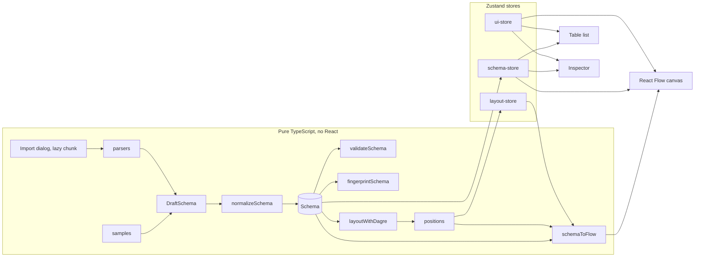

# Diagram: data flow

How a schema gets from input to pixels. Used by [ARCHITECTURE](../ARCHITECTURE.md) and
[SYSTEM_DESIGN](../SYSTEM_DESIGN.md). Source of truth:
[development/ARCHITECTURE.md](../development/ARCHITECTURE.md#data-flow).

