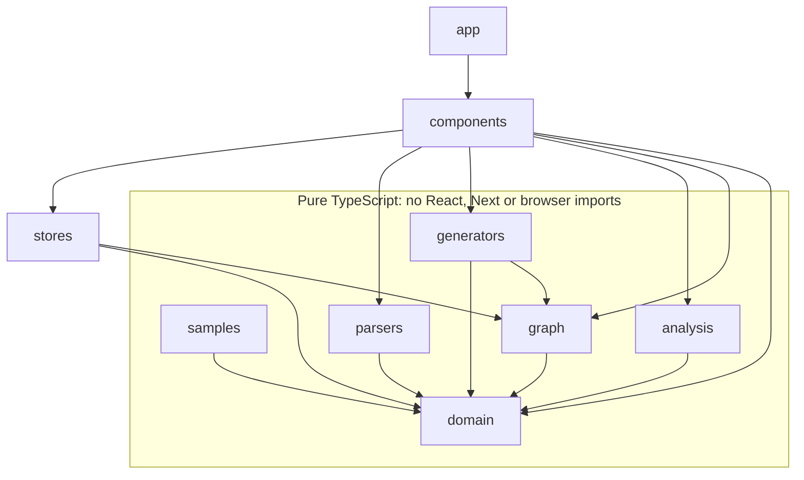

# Diagram: module boundaries

Which folder may import which. Arrows point from the importer to the imported folder. Used by
[ARCHITECTURE](../ARCHITECTURE.md), [SYSTEM_DESIGN](../SYSTEM_DESIGN.md) and
[PROJECT_STRUCTURE](../PROJECT_STRUCTURE.md). Table form:
[development/ARCHITECTURE.md](../development/ARCHITECTURE.md#module-boundaries).

Two rules the picture cannot show: parsers never import React Flow, and canvas components never
import parsers (only the Import dialog does, through a lazy chunk). `src/graph` imports only types
from `@xyflow/react`.
