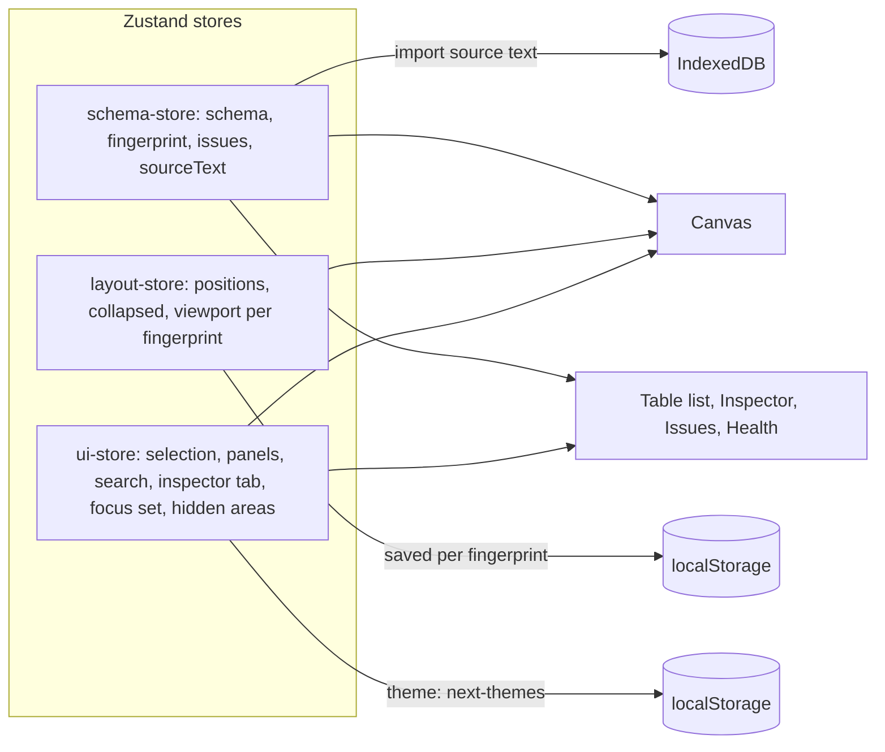

# Diagram: the three stores

What each Zustand store owns and who reads it. Used by [FRONTEND_ARCHITECTURE](../FRONTEND_ARCHITECTURE.md)
and [ARCHITECTURE](../ARCHITECTURE.md). Full slice list:
[development/ARCHITECTURE.md](../development/ARCHITECTURE.md#state-slices-srcstores).

